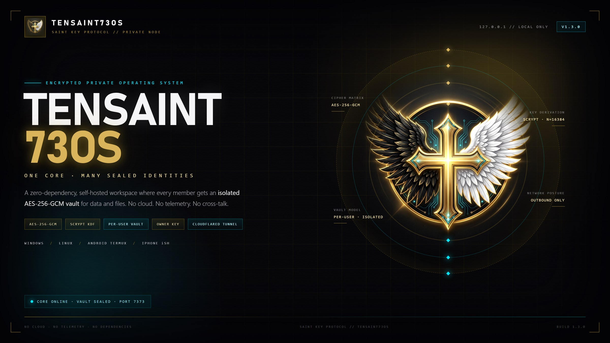
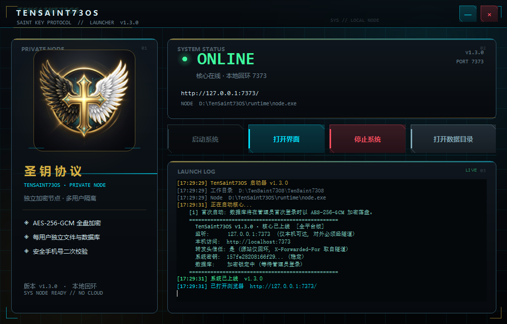
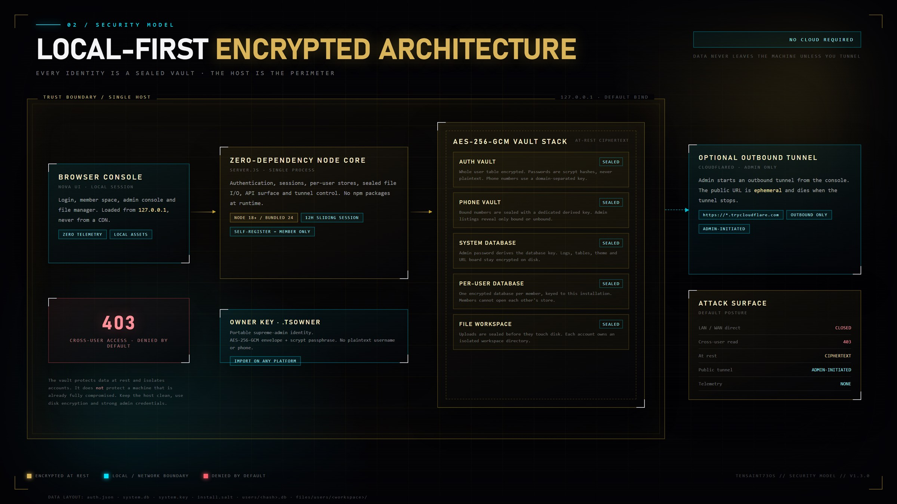
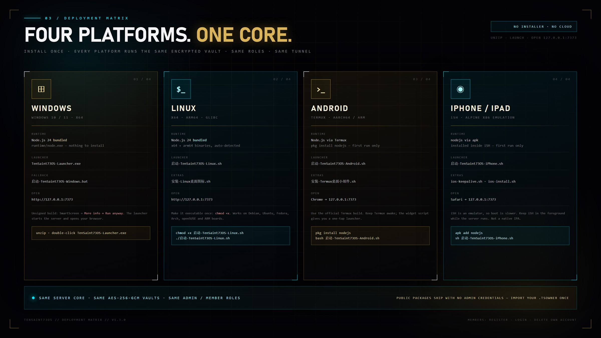

<div align="center">
  
</div>

<h1 align="center">TenSaint73OS</h1>

<p align="center"><strong>THE SAINT KEY PROTOCOL</strong><br>
A local-first, zero-dependency, encrypted multi-user workspace that runs on Windows, Linux, Android and iPhone/iPad.</p>

<p align="center">
  <code>AES-256-GCM</code> · <code>scrypt</code> · <code>PER-USER VAULTS</code> · <code>PHONE 2FA</code> · <code>OWNER KEY</code> · <code>OPTIONAL CLOUDFLARE TUNNEL</code>
</p>

<p align="center"><strong>Version 1.3.0</strong> · Node.js 18+ · no npm runtime dependencies · no telemetry · no cloud account</p>

> **Public builds are member-only on first launch.**
> They contain **no admin account, no real database and no keys**.
> The instance owner becomes supreme administrator through a private `admin.env`
> or by importing an encrypted `.tsowner` owner key. Everything else can only
> register, log in, log out and delete its own account.

---

## Table of contents

1. [What is TenSaint73OS?](#1-what-is-tensaint73os)
2. [An honest definition](#2-an-honest-definition)
3. [Feature overview](#3-feature-overview)
4. [Screenshots](#4-screenshots)
5. [Security architecture](#5-security-architecture)
6. [Four platforms, one core](#6-four-platforms-one-core)
7. [Quick start](#7-quick-start)
8. [Owner key reference](#8-owner-key-reference)
9. [Public tunnel](#9-public-tunnel)
10. [Configuration](#10-configuration)
11. [Data, backup and recovery](#11-data-backup-and-recovery)
12. [Project structure](#12-project-structure)
13. [API appendix](#13-api-appendix)
14. [Run from source](#14-run-from-source)
15. [Hardening checklist](#15-hardening-checklist)
16. [FAQ](#16-faq)
17. [Troubleshooting](#17-troubleshooting)
18. [License and disclaimer](#18-license-and-disclaimer)

---

## 1. What is TenSaint73OS?

TenSaint73OS is a small, self-contained server and web console for people who
want a **private digital space that does not depend on a cloud provider**.

You unzip it, launch it, and open `http://127.0.0.1:7373` in a browser. The
server binds to loopback only. Data is encrypted before it is written to disk.
The owner has a supreme administrator identity; everybody else is a member with
an isolated encrypted database and an isolated encrypted file workspace.

It is built for four situations in particular:

- A private workspace on a personal Windows PC or Linux machine.
- A pocket server on Android through Termux.
- An iPhone/iPad demo or secondary node through iSH.
- A temporary, globally reachable endpoint created with an outbound Cloudflare
  tunnel — without opening a router port or owning a public IP.

The project deliberately has **zero runtime npm dependencies**. The entire server
is the Node.js standard library plus the files in `core/`. That keeps the attack
surface small, makes offline installation possible, and means there is no
`npm install` step that can break years later.

### Design principles

| Principle | How it is implemented |
|---|---|
| **Local-first** | Binds `127.0.0.1` by default; no outbound connection unless the owner starts a tunnel. |
| **Encrypted at rest** | Auth vault, system database, per-user databases and uploaded files are AES-256-GCM envelopes. |
| **Least privilege** | Self-registration can only create a `user`. Admin creation is a separate, owner-only bootstrap. |
| **Per-user isolation** | Separate database file and workspace directory per member; API checks ownership on every request. |
| **Portable identity, separate data** | A `.tsowner` key restores the supreme admin identity on another machine; it intentionally does **not** copy that machine's data. |
| **No magic** | Plain Node.js, plain JSON envelopes, no proprietary service, no telemetry, no license server. |

---

## 2. An honest definition

The name contains “OS”, but this is **not a bootable operating system** and not a
kernel. It is an application-layer private workspace with an OS-like console.

It is also **not a native mobile app**. There is no APK and no IPA in this
repository. The Android build runs inside **Termux**; the iPhone/iPad build runs
inside **iSH** (an x86 Linux emulator available on the App Store). Both are real,
usable ways to run the same Node.js core on a phone, but neither is a signed
native package. Anyone who claims to convert this project into a working IPA
without a Mac, Xcode and an Apple signing identity is not telling the truth.

What *is* real:

- One codebase, four documented launch paths.
- A self-contained runtime for Windows and Linux (Node.js 24.18.0 bundled).
- A browser console that works on desktop and mobile widths.
- Encrypted storage that survives restarts and can be backed up.
- An owner identity that can be restored on another machine without shipping
  credentials inside the public download.

---

## 3. Feature overview

### Identity and access

- Supreme administrator (`admin`) and ordinary members (`user`).
- Public registration always creates a member — never an administrator.
- Member self-service: change password, bind/unbind a security phone, delete
  their own account and everything inside it.
- Security phone as a second factor: once bound, login requires **password +
  phone number**.
- Admin can disable new registrations at runtime.
- Session tokens are random, expire after 12 hours of inactivity, and are
  revoked when a password changes or an account is deleted.

### Encrypted storage

- Encrypted authentication vault (`data/auth.json`).
- Encrypted system database (`data/system.db`) unlocked by the admin password.
- One encrypted database per member (`data/users/<sha256(username)>.db`).
- Encrypted file workspace per member (`data/files/users/<workspace>/`).
- Uploaded files are sealed before they touch the disk; they are never stored
  as plaintext.
- Install-unique salt (`data/install.salt`) separates one deployment from another.
- Core-file manifest detects changes to the application files and rotates the
  system key value on the next boot.

### Console

- Real-time system core page, member dashboard, database browser, file manager,
  user management, audit log, network matrix, URL board and tunnel control.
- Admin console and member console are separate experiences.
- Mobile navigation layout for narrow screens.
- Current UI language: **Simplified Chinese** (the code and API are English).

### Network

- Loopback-only by default.
- Admin-only, in-console Cloudflare Quick Tunnel: install, start, stop.
- Ephemeral `https://*.trycloudflare.com` address, also recorded in the URL board.
- Optional named tunnel configuration for a stable hostname (requires your own
  Cloudflare account and domain).
- No inbound port forwarding is required.

### Operations

- Backup script for Termux; folder-level backup for desktop platforms.
- No npm dependencies, no build step, no database server, no Docker requirement.
- Works on Node.js 18+; Windows/Linux packages bundle Node.js 24.18.0.

---

## 4. Screenshots

> All screenshots use **synthetic demo accounts** (`demo_vault_889791`) and a
> fake tunnel URL. They contain no real administrator name, phone number or data.

<table>
  <tr>
    <td width="50%"><br><sub><b>Windows launcher</b> — bundled runtime, start/stop, live log.</sub></td>
    <td width="50%"><br><sub><b>Login</b> — password plus optional bound-phone second factor.</sub></td>
  </tr>
  <tr>
    <td><br><sub><b>Admin console</b> — encrypted system database unlocked, live telemetry.</sub></td>
    <td><br><sub><b>Member space</b> — isolated per-user vault and workspace.</sub></td>
  </tr>
  <tr>
    <td><br><sub><b>Account security</b> — phone binding, password, permanent deletion.</sub></td>
    <td><br><sub><b>Tunnel control</b> — admin-only outbound Cloudflare tunnel.</sub></td>
  </tr>
</table>

---

## 5. Security architecture

<div align="center">
  
</div>

### 5.1 Trust boundary

The browser talks to a Node.js process on the same machine over loopback. The
host is the security perimeter: if the operating system is compromised, the
application cannot defend its data. Encryption protects **data at rest**, not a
machine that is already under an attacker's control.

There are only two network paths into the console:

1. `127.0.0.1:7373` (default), reachable only from the same machine.
2. An outbound Cloudflare tunnel initiated by an administrator. Cloudflare
   connects **out** to the internet; no inbound firewall port is opened.

### 5.2 Cryptography at rest

| Asset | Cipher / KDF | Key source | Notes |
|---|---|---|---|
| Auth vault (`auth.json`) | AES-256-GCM | `SHA-256("TenSaint73OS::" + install.salt)` | Entire user table is one encrypted envelope. |
| Login password | scrypt (N=16384, r=8, p=1, 64-byte output) | Random 16-byte salt per user | Only the hash is stored. |
| Phone number | AES-256-GCM | `HMAC-SHA256(installKey, "TenSaint73OS::phone-vault::v1")` | Domain-separated from the vault key. A scrypt hash is also stored for login verification. |
| System database (`system.db`) | AES-256-GCM envelope + scrypt KDF | Admin password + random salt | Locked until an administrator logs in. |
| User database (`users/*.db`) | AES-256-GCM | `SHA-256("TenSaint73OS::userdata::v1::" + install.salt)` | Independent of the admin password; members can work while the system DB is locked. |
| Uploaded files | AES-256-GCM (`TSF1` container) | scrypt(install.salt, `"TenSaint73OS::files::v1"`) | Sealed before `writeFileSync`. |
| Sessions | 24 random bytes, 12-hour sliding TTL | In memory | Restarting the server invalidates all sessions. |
| Owner key (`.tsowner`) | AES-256-GCM envelope + scrypt KDF | Owner passphrase | Contains no plaintext username, password hash or phone number outside the envelope. |

All encryption keys are generated locally. There is no project-operated key
server, account system or recovery service.

### 5.3 Roles and enforcement

| Capability | Supreme admin | Member |
|---|:---:|:---:|
| Register through the public page | — | Yes |
| Login with password | Yes | Yes |
| Login with password + bound phone | Yes | Yes |
| Open the admin console | Yes | No |
| See the global encrypted system database | Yes | No |
| Create/drop tables in own space | Yes (global) | Yes (own) |
| Read another member's private vault/files | No (not exposed by the console) | No |
| Manage users and feature grants | Yes | No |
| Start/stop the public tunnel | Yes | No |
| Change own password | Yes | Yes |
| Bind/unbind own phone | Yes | Yes |
| Permanently delete own account and its data | Yes | Yes |

Server-side enforcement is a whitelist (`MEMBER_ROUTES`) plus an administrator
check in `handleApi`. A member request to any other route receives `403` before
the handler runs. The client UI is not the security boundary.

### 5.4 Phone second factor

When a phone is bound:

- The login request must contain the same normalized phone number.
- The number is encrypted with a key derived separately from the auth-vault key.
- A scrypt hash is kept for constant-time verification.
- Administrator user lists expose only **bound / unbound**, never the number.
- Only the owner's own authenticated session can retrieve the full number.
- A phone change or unbind requires the current password **and** the current
  phone, and revokes other sessions.

This is a strong second factor against password theft, but it is not a hardware
security key. Anyone who controls both the password and the bound SIM can log in.

### 5.5 Per-user isolation

Each member gets:

- `data/users/<sha256(username)>.db` — a separate AES-256-GCM database.
- `data/files/users/<workspace>/` — a separate encrypted workspace.

The API resolves the caller's own root on every request and refuses paths that
escape it. Members cannot enumerate or open another member's store through the
console. The administrator console is designed not to expose member vault
contents either.

**Important boundary:** the Node process holds the installation keys and runs on
the owner's machine. A malicious host operator could instrument the process or
read its memory. The isolation is an application/API guarantee plus encryption
at rest; it is not a cryptographic guarantee against the machine owner. Run this
software only on hardware you trust.

### 5.6 Sessions and brute-force resistance

- Tokens are 24 random bytes, hexadecimal encoded.
- 12-hour sliding expiration; activity extends the window.
- Login failures are counted per client IP; five failures lock that IP for 60
  seconds.
- Password changes, phone changes and deletions revoke the affected sessions.
- When the server is behind the tunnel, client IPs are taken from
  `X-Forwarded-For` only because the origin socket is loopback and the proxy is
  trusted. `TS_TRUST_PROXY=0` disables that behavior.

### 5.7 File manifest and key rotation

On boot, the server hashes the application files (root files, `core/`, `public/`)
and compares them with `data/manifest.json`. If files were moved, added, removed
or modified, it rotates the in-memory system key value and records a new
baseline. This is a tamper signal for the console; it is **not** a code-signing
or anti-malware system.

### 5.8 What the model does not protect

Be explicit about the limits:

- A compromised OS, keylogger or malicious browser extension can capture
  credentials before encryption is applied.
- An attacker with root can access process memory and derived keys.
- Cloudflare terminates TLS at its edge. It can observe traffic in transit even
  though data on disk is encrypted.
- A weak admin password undermines the system database envelope. Use a long,
  unique password and keep the bound phone private.
- A copied `data/` folder that includes `install.salt` plus the application can
  be decrypted by someone who also knows the passwords. Treat backups as secrets.
- The quick tunnel is convenient, not a production SLA. It is rate-limited,
  ephemeral and visible to anyone who obtains the URL.

### 5.9 Owner key (`.tsowner`)

The owner key solves a specific problem: the public package cannot contain admin
credentials, yet the owner wants to sign in as supreme administrator on **any
machine of any supported platform**.

The `.tsowner` file is a portable, encrypted copy of the administrator identity:
username, password hash, role, creation time, salt and the bound phone record.
It is encrypted with a passphrase using AES-256-GCM and scrypt. The file contains
no usable plaintext identity. Importing it on a fresh installation writes the
admin into the new machine's auth vault and re-encrypts the phone under that
installation's key.

It does **not** migrate `system.db`, member databases, files or the old install
salt. Identity is portable; data remains per-device.

---

## 6. Four platforms, one core

<div align="center">
  
</div>

| | Windows | Linux | Android | iPhone / iPad |
|---|---|---|---|---|
| Package | `TenSaint73OS-Windows-x64.zip` | `TenSaint73OS-Linux-x64-arm64.zip` | `TenSaint73OS-Android-Termux.zip` | `TenSaint73OS-iPhone-iSH.zip` |
| Runtime | Node.js 24.18.0 **bundled** | Node.js 24.18.0 **bundled** (x64 + arm64) | Node.js installed by Termux | Node.js installed by iSH/Alpine |
| Launcher | `TenSaint73OS-Launcher.exe` | `启动-TenSaint73OS-Linux.sh` | `启动-TenSaint73OS-Android.sh` | `启动-TenSaint73OS-iPhone.sh` |
| UI | Default browser → `127.0.0.1:7373` | Browser | Chrome | Safari |
| Native app? | Desktop executable | Shell + browser | Not an APK | Not an IPA |
| Tunnel host | Recommended | Recommended | Good (keep awake) | Not recommended |
| Data location | `TenSaint73OS\data` | `TenSaint73OS/data` | `~/TenSaint73OS/data` | `~/TenSaint73OS/data` |

The **viewer can be any device**: once a tunnel is running, a Windows PC, Mac,
Linux laptop, Android phone, iPhone or iPad with internet can open the HTTPS
address. The four packages describe where the *server* runs, not who may connect.

### 6.1 Windows 10 / 11 (x64)

1. Unzip the whole archive to a normal folder. Do not run it inside the ZIP.
2. Double-click `TenSaint73OS-Launcher.exe`.
3. The launcher starts the bundled Node runtime, shows the live log and opens
   the console. Use **打开界面** if the browser does not open automatically.
4. If SmartScreen appears: **More info → Run anyway**. The executable is
   unsigned; the source is in this repository.
5. Fallback: `启动-TenSaint73OS-Windows.bat` keeps a visible console.

The package bundles `runtime\node.exe`; Node.js does not need to be installed.
The service listens on `127.0.0.1:7373` only.

### 6.2 Linux (x64 / arm64)

```bash
unzip TenSaint73OS-Linux-x64-arm64.zip
cd TenSaint73OS-Linux
chmod +x *.sh
./启动-TenSaint73OS-Linux.sh
```

The launcher detects x86_64 or aarch64 and uses the matching bundled Node
binary. It requires glibc 2.28+ (Debian 10, Ubuntu 18.10, RHEL 8 or newer).
On musl/Alpine or older systems, install the distribution's Node.js 18+ and the
script falls back to `node` from `PATH`.

Optional application-menu entry:

```bash
./安装-Linux桌面图标.sh
```

### 6.3 Android (Termux)

This is a Termux application, not an APK.

1. Install **Termux** from F-Droid (the Play Store build is outdated).
2. Optional: install **Termux:Widget** and **Termux:Boot**.
3. In Termux:

```bash
termux-setup-storage
pkg install -y unzip
cd ~
unzip ~/storage/downloads/TenSaint73OS-Android-Termux.zip -d ~/
cd ~/TenSaint73OS-Android-Termux
sh 启动-TenSaint73OS-Android.sh
```

The first launch installs Node.js LTS through `pkg` (internet required once).
Then open Chrome at `http://127.0.0.1:7373`. Use **Add to Home screen** for an
app-like icon. Set Termux battery optimization to **Unrestricted** and acquire a
wake lock for long sessions. A desktop widget helper is included:

```bash
sh ~/TenSaint73OS-Android-Termux/安装-Termux桌面小部件.sh
```

For the in-console tunnel on Termux, `pkg install -y cloudflared` is the most
reliable way to provide the binary.

### 6.4 iPhone / iPad (iSH)

This is not an IPA. It runs inside **iSH**, the x86 Alpine emulator from the App
Store.

1. Install iSH from the App Store.
2. Put the ZIP where the Files app can see it, then in iSH:

```bash
mkdir -p ~/ios
mount -t ios . ~/ios      # choose the folder in the picker
cd ~/ios
unzip TenSaint73OS-iPhone-iSH.zip -d ~/
cd ~/TenSaint73OS-iPhone-iSH
sh 启动-TenSaint73OS-iPhone.sh
```

The first run installs `nodejs`, `npm` and `unzip` with `apk`. Open Safari at
`http://127.0.0.1:7373` and use **Share → Add to Home Screen**.

iOS suspends iSH when you switch to Safari. Data is not lost, but the server
pauses. Keep iSH in the foreground for active use; an optional keep-alive script
(`TenSaint73OS/ios-keepalive.sh`) exists but is battery-intensive and not
guaranteed. Because of this, **iSH is a demo/secondary node, not the recommended
always-on tunnel host**.

### 6.5 Why no native APK or IPA?

- A real IPA requires macOS, Xcode and an Apple signing identity. Cross-compiling
  a Node.js server + WebView into a signed IPA from Windows is not possible with
  this project's constraints.
- A native Android app would add a large toolchain and an APK signing pipeline,
  while Termux already provides a complete Linux userland with Node.js.
- The web console is the same on every platform, so there is one UI to secure
  and maintain instead of four native codebases.

---

## 7. Quick start

### 7.1 Default: member-only mode

A fresh public package has no admin. Start it, open the console, click
**注册 (Register)** and create a member account. That account can:

- log in and log out,
- use its own encrypted database and file workspace,
- bind a phone number,
- permanently delete itself.

It cannot see the admin console, other members, the tunnel controls or the
global system database.

### 7.2 Create the supreme admin on a fresh install (owner bootstrap)

Do this **before the first start**, or before any account exists:

1. Copy `data/admin.env.example` to `data/admin.env`.
2. Set:

```dotenv
TS_ADMIN_USER=your-private-admin-name
TS_ADMIN_PASS=a-long-unique-password
```

3. Start the server. On an empty auth vault, it creates exactly one admin with a
   scrypt hash. The plaintext password is not stored.
4. Delete `data/admin.env` after the account exists, or at least keep it private
   and `chmod 600`.
5. Log in as the admin. This also unlocks/initializes the encrypted
   `data/system.db`.

The environment variables `TS_ADMIN_USER` / `TS_ADMIN_PASS` take precedence over
`admin.env`. Once any account exists, the bootstrap is skipped forever; public
registration cannot create another admin.

> The admin password is also the key material for the system database. If you
> forget it, `system.db` cannot be decrypted. Store it in a password manager and
> keep an offline backup.

### 7.3 Restore the supreme admin on any platform with `.tsowner`

On the **original** device, fully stop the server, then run the owner tool:

- Windows: `owner\Export-Owner-Key.bat`
- Linux / Termux / iSH: `sh owner/export-owner-key.sh`

You will be asked for the admin password, the bound phone (if any), and a new
owner-key passphrase (at least 8 characters). The tool writes an encrypted
`.tsowner` file. Keep it separate from the passphrase.

On the **new** device, with a fresh TenSaint73OS installation and no admin
account, run:

- Windows: `owner\Import-Owner-Key.bat`
- Linux / Termux / iSH: `sh owner/import-owner-key.sh`

Enter the `.tsowner` path and passphrase. The identity (including the encrypted
phone) is written into the new installation. Log in with the original password
plus the bound phone number. Member accounts created on the old device do not
come along, and the old device's databases are not copied.

### 7.4 First login and second factor

- Admin: username + password; if a phone is bound, add the exact phone number.
- Member: same rules.
- Public registration: username 2–20 characters, password at least 8 characters.
- After login, administrators land in the admin console; members land in their
  private space.

### 7.5 Stop the service

- Windows launcher: **停止系统** or close the launcher window.
- Terminal: `Ctrl+C`.
- Android widget/script sessions: close the Termux session after `Ctrl+C`.
- Stopping the server also stops an in-console tunnel and invalidates sessions.

---

## 8. Owner key reference

### 8.1 What is inside

A `.tsowner` document is JSON with this shape (values are illustrative only):

```json
{
  "magic": "TenSaint73OS-OWNER-KEY",
  "format": 1,
  "kdf": "scrypt(N=16384,r=8,p=1)",
  "cipher": "aes-256-gcm",
  "createdAt": "2026-01-01T00:00:00.000Z",
  "envelope": {
    "v": 1,
    "algo": "aes-256-gcm",
    "salt": "<random hex>",
    "iv": "<random hex>",
    "tag": "<auth tag>",
    "data": "<base64 ciphertext>"
  }
}
```

The encrypted payload contains the username, password hash, role, salt,
creation time and the phone record. The outer file deliberately has no plaintext
username or phone number.

### 8.2 Export requirements

- An existing administrator account.
- The admin password.
- The bound phone number, when one is bound.
- A new owner-key passphrase (8+ characters, entered twice).
- The server must be stopped; the tool checks the local API and refuses to run
  against a live instance.

### 8.3 Import rules

- Import is allowed only when **no administrator exists** on the target.
- A username collision is refused.
- The format, username, role, salt and hash lengths are validated.
- The phone is re-encrypted under the new installation key.
- The imported identity keeps the original password; the target's data stays
  independent.

### 8.4 Operational rules

1. Store the `.tsowner` file and its passphrase in **different** places.
2. Never commit it, email it, or put it in the same folder as the application.
3. If it leaks, the passphrase is the remaining protection; rotate the admin
   password and re-export a new key.
4. Export a fresh key after changing the admin password or phone.
5. Losing the key does not destroy the current device's login, but it removes
   your easy recovery path on other machines.

---

## 9. Public tunnel

### 9.1 What it does

An administrator can start an outbound **Cloudflare Quick Tunnel** from the
console (`网络矩阵 → 隧道控制`) or with `run-online.sh`. The server spawns
`cloudflared`, which connects out to Cloudflare and prints a random HTTPS URL:

```text
https://random-words-1234.trycloudflare.com
```

The URL is written to the URL board and `data/tunnel.url`. It works globally:
any device with internet can open it and reach the login page. No router port
forwarding, public IP or DNS record is required.

### 9.2 The fine print

- **Host must stay online.** If the computer sleeps, Termux is killed, iSH is
  suspended, or the server exits, the URL stops working.
- **The URL is ephemeral.** A restart creates a new random address. Only a named
  Cloudflare tunnel with your own domain gives a stable hostname.
- **No SLA.** Quick Tunnels are a convenience feature. Cloudflare may rate-limit,
  throttle or change them.
- **Anyone with the URL can reach the login page.** They still need an account;
  the public build cannot create an admin. Registration is open by default, so
  disable it in the admin settings before sharing the URL broadly.
- **TLS terminates at Cloudflare.** Data on disk is encrypted, but Cloudflare can
  observe traffic at its edge. Do not treat this as end-to-end encryption.
- **Host recommendations:** Windows, Linux or a charged Android/Termux device
  with battery optimization disabled. iPhone/iSH is not a reliable tunnel host.
- **Stop the tunnel when done.** The console's stop button ends the child process
  and the URL immediately.

### 9.3 In-console installation

`/api/tunnel/install` downloads the matching `cloudflared` asset from Cloudflare's
official release channel into `tools/`. On Termux, prefer:

```bash
pkg install -y cloudflared
```

On iSH, a compatible binary is not guaranteed. Use a desktop host or access a
desktop host's tunnel from the iPhone.

### 9.4 Named tunnel (optional, stable URL)

If you own a domain on Cloudflare:

```bash
cloudflared tunnel login
cloudflared tunnel create tensaint
```

Place the credentials in `data/tunnel.json` and a `data/tunnel.yml` with your
hostname mapped to `http://localhost:7373`. Start with:

```bash
TS_TUNNEL_NAME=tensaint TS_PUBLIC_URL=https://your.domain ./run-online.sh
```

Do not expose port 7373 directly. Plain HTTP would send passwords in the clear.

---

## 10. Configuration

### 10.1 Environment variables

| Variable | Default | Purpose |
|---|---|---|
| `TS_PORT` | `7373` | HTTP port. |
| `TS_BIND` | `127.0.0.1` | Listen address. Changing to `0.0.0.0` exposes plaintext HTTP to the LAN. |
| `TS_TRUST_PROXY` | auto | `1` trusts `X-Forwarded-For`; auto-on only for loopback binds. |
| `TS_ADMIN_USER` | — | Bootstrap admin username, only used when the auth vault is empty. |
| `TS_ADMIN_PASS` | — | Bootstrap admin password (8+ chars), only used when the vault is empty. |
| `TS_PUBLIC_URL` | — | Optional public URL shown in the console; used by `run-online.sh`. |
| `TS_TUNNEL_NAME` | — | Named Cloudflare tunnel to run. |
| `TS_CLOUDFLARED` | — | Explicit path to a `cloudflared` binary. |
| `LAUNCH_OPEN` | — | `1` opens the browser on start (used by launchers). |
| `TS_BACKUP_PW` | — | Passphrase consumed by `backup.sh` (not stored). |

### 10.2 Runtime configuration file

`data/config.json` stores:

```json
{
  "port": 7373,
  "registration": true
}
```

- `registration`: administrators can toggle it from the console; when `false`,
  `/api/register` returns `403`.
- Port changes made through the console are persisted here and require a restart.

### 10.3 URLs

- Local console: `http://127.0.0.1:7373`
- API base: `http://127.0.0.1:7373/api`
- Public tunnel: `https://<random>.trycloudflare.com`
- LAN (only if you explicitly set `TS_BIND=0.0.0.0`): `http://<lan-ip>:7373`

---

## 11. Data, backup and recovery

### 11.1 Data layout

```text
TenSaint73OS/
├─ data/
│  ├─ install.salt              # install-unique key material (critical)
│  ├─ auth.json                 # AES-256-GCM auth vault
│  ├─ system.key                # system key value (rotates on file changes)
│  ├─ manifest.json             # application file hashes
│  ├─ config.json               # port / registration flags
│  ├─ system.db                 # encrypted global database (admin password)
│  ├─ users/
│  │  └─ <sha256(username)>.db  # one encrypted DB per member
│  ├─ files/
│  │  └─ users/<workspace>/     # encrypted member files
│  ├─ admin.env                 # optional private bootstrap (never publish)
│  ├─ tunnel.yml / tunnel.json  # optional named-tunnel config
│  ├─ tunnel.url / public_url.txt
│  └─ tunnel.log
├─ core/                        # crypto, auth, stores, util, AI helper
├─ public/                      # console UI (HTML/CSS/JS/assets)
├─ owner/                       # owner-key export/import tools
├─ server.js                    # zero-dependency server
├─ start.sh / run-online.sh
├─ backup.sh
└─ README.txt / README-iOS.txt / DEPLOY.txt
```

### 11.2 Back up

**Desktop (Windows/Linux):** stop the server, then copy the entire
`TenSaint73OS` folder to an encrypted disk or encrypted archive.

**Termux:**

```bash
cd ~/TenSaint73OS
./backup.sh
```

This creates `/sdcard/Download/tensaint-backup-YYYYMMDD-HHMM.tar.gz.enc` using
OpenSSL AES-256-CBC with PBKDF2 (200,000 iterations). The archive is encrypted
again because it contains `install.salt`, which is the key to the rest of the
data.

**iSH:** stop the server and copy the `TenSaint73OS/data` folder into the Files
app, or create a tar archive inside iSH and move it out.

### 11.3 Restore

Restore **everything together**:

- `install.salt`
- `auth.json`
- `system.db`
- `system.key`
- `manifest.json`
- `config.json`
- `users/`
- `files/`

`system.db` alone is useless without the admin password; `auth.json` alone is
useless without `install.salt`; user databases are useless without the install
salt. Do not mix files from two different installations.

For a `backup.sh` archive:

```bash
export TS_BACKUP_PW='the-backup-passphrase'
openssl enc -d -aes-256-cbc -pbkdf2 -iter 200000 \
  -in tensaint-backup-YYYYMMDD-HHMM.tar.gz.enc -pass env:TS_BACKUP_PW \
  | tar -xzf - -C ~/TenSaint73OS
```

### 11.4 Move to another machine

- To move the **data**, copy the complete `data/` plus the application files and
  keep the same admin password. The install salt must travel with the data.
- To move only the **admin identity**, use `.tsowner`. The new machine starts with
  empty data and its own member accounts.
- Copying `data/` without the application manifest may rotate the system key on
  first boot (a tamper signal). Keep a backup before experimenting.

---

## 12. Project structure

```text
TenSaint73OS/                 # this repository
├─ server.js                  # HTTP server, routes, tunnel, bootstrap
├─ core/
│  ├─ auth.js                 # users, sessions, phone vault, rate limits
│  ├─ crypto-util.js          # scrypt hashing, AES-256-GCM envelopes
│  ├─ store.js                # encrypted system database
│  ├─ userstore.js            # per-user encrypted database
│  ├─ ai.js                   # optional local assistant helper
│  └─ util.js                 # filesystem/JSON helpers
├─ public/
│  ├─ index.html              # console shell
│  ├─ css/style.css
│  ├─ js/app.js
│  ├─ icons/                  # PWA icons
│  ├─ logo.png
│  └─ manifest.webmanifest
├─ owner/
│  ├─ owner-vault.js          # portable admin identity tool
│  ├─ Export-Owner-Key.bat
│  ├─ Import-Owner-Key.bat
│  ├─ export-owner-key.sh
│  ├─ import-owner-key.sh
│  └─ README.txt
├─ screenshots/               # sanitized demo screenshots
├─ docs/                      # README artwork
├─ data/admin.env.example     # bootstrap template only
├─ start.sh / run-online.sh / backup.sh
├─ ios-install.sh / ios-start.sh / ios-keepalive.sh
├─ README.txt / README-iOS.txt / DEPLOY.txt
└─ package.json               # name, version, start script
```

Release ZIPs add the platform launchers and, for Windows/Linux, a `runtime/`
folder with the Node.js binary. The Git repository intentionally excludes
binaries and real data.

---

## 13. API appendix

All authenticated requests use:

```http
Authorization: Bearer <session-token>
Content-Type: application/json
```

### 13.1 Public endpoints

| Method | Path | Purpose |
|---|---|---|
| `GET` | `/api/state` | Version, current role, registration flag, lock state. |
| `GET` | `/api/theme` | Public theme defaults. |
| `POST` | `/api/register` | Create a member account. Always role `user`. |
| `POST` | `/api/login` | Password + optional bound phone. Returns a token. |
| `POST` | `/api/logout` | Destroy the bearer token. |

### 13.2 Member endpoints

| Method | Path | Purpose |
|---|---|---|
| `GET` | `/api/my` | Own profile and space summary. |
| `POST` | `/api/me/password` | Change own password; revokes other sessions. |
| `GET` | `/api/me/phone` | Read own decrypted phone (self only). |
| `POST` | `/api/me/phone` | Bind or replace phone. |
| `POST` | `/api/me/phone/unbind` | Unbind with password + current phone. |
| `POST` | `/api/me/delete` | Permanently delete own account, DB and files. |
| `GET` | `/api/db/tables` | List tables in own store. |
| `POST` | `/api/db/create` | Create a table. |
| `POST` | `/api/db/drop` | Drop a table. |
| `GET` | `/api/db/table` | Read rows. |
| `POST` | `/api/db/insert` | Insert a row. |
| `POST` | `/api/db/update` | Update rows. |
| `POST` | `/api/db/delete` | Delete rows. |
| `POST` | `/api/db/clear` | Clear a table. |
| `POST` | `/api/db/addcol` | Add a column. |
| `POST` | `/api/db/delcol` | Delete a column. |
| `GET` | `/api/fs/list` | List own encrypted workspace. |
| `POST` | `/api/fs/mkdir` | Create a directory. |
| `POST` | `/api/fs/upload` | Upload base64 data; sealed before write. |
| `GET` | `/api/fs/download` | Decrypt and download a file. |
| `POST` | `/api/fs/delete` | Delete a file or directory. |

Member quotas: 60 tables, 5,000 rows per table, 32 columns per table. Request
bodies are capped at 50 MB (uploads are base64-encoded, so the raw file is
smaller than that).

### 13.3 Administrator endpoints

Administrators can call all member endpoints (against the global store/workspace)
and additionally:

| Group | Representative paths |
|---|---|
| Overview | `GET /api/overview` |
| Users | `GET /api/users`, `POST /api/users/create`, `POST /api/users/delete`, `GET /api/users/space`, `GET/POST /api/grants*` |
| Features | `GET /api/features`, `POST /api/features/toggle`, `POST /api/features/add`, `POST /api/features/remove` |
| Theme | `POST /api/theme/set`, `POST /api/theme/reset` |
| Logs | `GET /api/logs`, `POST /api/logs/clear` |
| Network | `GET /api/network` |
| Tunnel | `GET /api/tunnel/status`, `POST /api/tunnel/start`, `POST /api/tunnel/stop`, `POST /api/tunnel/install` |
| URL board | `GET /api/urls`, `POST /api/urls/add`, `POST /api/urls/delete`, `POST /api/urls/current`, `POST /api/urls/clear` |
| Settings | `POST /api/settings/port`, `POST /api/settings/registration` |
| System | `POST /api/system/restart`, `POST /api/system/lock`, `POST /api/key/rotate` |
| Tools | `GET /api/tools/random`, `POST /api/tools/hash`, `POST /api/ai` |

A member calling an administrator path receives `403` with
`"权限不足: 该内容仅最高权限账号可见"`. An administrator calling an admin route before
the system database is unlocked receives an error until the admin logs in.

---

## 14. Run from source

Requirements: Node.js 18 or newer (24.x recommended). There is no install step.

```bash
git clone https://github.com/<your-account>/TenSaint73OS.git
cd TenSaint73OS
node server.js
```

Open `http://127.0.0.1:7373`.

To create the admin on first boot:

```bash
# macOS / Linux / Termux / iSH
TS_ADMIN_USER=owner TS_ADMIN_PASS='a-long-unique-password' node server.js
```

```bat
:: Windows cmd
set TS_ADMIN_USER=owner
set TS_ADMIN_PASS=a-long-unique-password
node server.js
```

> Never commit `data/`, `admin.env`, `*.tsowner`, backups or runtime binaries.
> The repository's `.gitignore` already excludes them.

### Release packages

The GitHub Releases contain:

| File | Approx. size | Contents |
|---|---|---|
| `TenSaint73OS-Windows-x64.zip` | ~36 MB | Source + `runtime/node.exe` + GUI launcher |
| `TenSaint73OS-Linux-x64-arm64.zip` | ~87 MB | Source + Node x64/arm64 + launch scripts |
| `TenSaint73OS-Android-Termux.zip` | ~2.6 MB | Source + Termux scripts, no runtime |
| `TenSaint73OS-iPhone-iSH.zip` | ~2.6 MB | Source + iSH scripts, no runtime |
| `SHA256SUMS.txt` | small | SHA-256 of the four archives |

Verify a download:

```bash
# Linux / macOS / Termux / iSH
sha256sum TenSaint73OS-*.zip
# or
shasum -a 256 TenSaint73OS-*.zip
```

```powershell
# Windows PowerShell
Get-FileHash .\TenSaint73OS-Windows-x64.zip -Algorithm SHA256
```

Compare with `SHA256SUMS.txt` before launching. Builds are unsigned; SmartScreen
or Gatekeeper warnings are expected.

---

## 15. Hardening checklist

- [ ] Replace any bootstrap password with a long, unique admin password.
- [ ] Bind the admin phone number and keep the SIM/phone secure.
- [ ] Import/export the `.tsowner` key and store file + passphrase separately.
- [ ] Disable public registration before sharing a tunnel URL broadly.
- [ ] Keep the default loopback bind; do not port-forward 7373.
- [ ] Use the tunnel only when needed and stop it afterward.
- [ ] Keep the host OS, Node.js and cloudflared patched.
- [ ] Encrypt the disk (BitLocker, LUKS, FileVault, Android encryption).
- [ ] Keep offline backups of `data/` and test a restore.
- [ ] Do not run the server on a machine you do not trust.
- [ ] Rotate the admin password and re-export `.tsowner` after any suspected leak.
- [ ] Treat screenshots, logs and backups as sensitive.

---

## 16. FAQ

**Is TenSaint73OS a real operating system?**
No. It is an application-layer encrypted workspace with a console that feels
OS-like. It does not boot a machine.

**Can I install it as an APK or IPA?**
No. Android uses Termux; iPhone/iPad uses iSH. Native packages would require a
different toolchain and, for iOS, a Mac plus Apple signing.

**Can I log in as supreme admin from a public GitHub download on any platform?**
Yes — if you are the owner and you import your encrypted `.tsowner` key on that
machine. The public ZIP itself contains no credentials, by design. Import once,
then log in with the original password and bound phone. Data does not sync.

**Why does the public build have no admin?**
Because shipping one would give every downloader the same supreme credentials.
The owner key is the secure way to carry the identity between machines.

**Can another member read my database or files?**
Through the console, no. Each member has a separate encrypted database and
workspace, and the API enforces ownership. The host operator, however, controls
the machine and the running process; see §5.8.

**Does the admin see my phone number?**
No. Admin lists show only bound/unbound. The number is encrypted with a
domain-separated key and only the owner's own session can retrieve it.

**Is registration open by default?**
Yes. The admin can disable it at runtime. Do that before sharing a public tunnel
URL with a large audience.

**Does the tunnel expose my data to the whole internet?**
It exposes the **login page** at an unguessable URL. Visitors still need an
account. The URL itself is a bearer secret: send it only to intended users, use
HTTPS, and stop the tunnel when finished.

**Can I use the tunnel from any device worldwide?**
Yes, while the host is online and the tunnel is running. The URL changes after a
restart and free Quick Tunnels have no uptime guarantee.

**Does it sync between devices?**
No. Each installation has its own encrypted data. The `.tsowner` key moves the
admin identity only.

**What happens if I forget the admin password?**
You cannot decrypt `system.db` on that installation. Restore from a backup with a
known password, or import a `.tsowner` on a fresh installation (which gives you
the identity but not the old data).

**Can I recover a member password?**
No. Passwords are one-way scrypt hashes. A member who forgets the password must
create a new account; their old encrypted data is not recoverable through the UI.

**Does it need Docker, a database server or npm?**
No. Only Node.js. Windows/Linux releases bundle it.

**Does it phone home?**
No telemetry or license check. The only outbound connection is the tunnel when an
admin starts it (and the one-time Node/cloudflared package download on Termux/iSH).

**Is the UI available in English?**
The current console is Simplified Chinese. The API and documentation are English.
Localization is a reasonable contribution area.

---

## 17. Troubleshooting

| Symptom | Likely cause | Fix |
|---|---|---|
| `EADDRINUSE` on start | Another instance is already listening | Open `http://127.0.0.1:7373` or stop the old process. |
| Browser does not open | Headless/SSH/no desktop | Open the URL manually. |
| Windows SmartScreen blocks the launcher | Unsigned executable | More info → Run anyway. Verify SHA-256 first. |
| Linux says permission denied | ZIP lost executable bits | `chmod +x *.sh`. |
| Bundled Node fails on Linux | musl/Alpine or glibc too old | Install Node.js 18+ from the distribution. |
| Termux says `node: command not found` | Node not installed | `pkg install -y nodejs-lts`. |
| iSH is very slow | x86 emulation | Normal; use a desktop host for heavy work. |
| Tunnel never prints a URL | No internet, cloudflared missing, firewall | Check `data/tunnel.log`; install cloudflared; test outbound HTTPS. |
| Tunnel stops when phone sleeps | OS background kill / iSH suspension | Disable battery optimization, keep the app foreground, or use a desktop host. |
| `auth.json` cannot be decrypted | `install.salt` missing or from another install | Restore the matching salt + vault backup. |
| Forgot admin password | System DB envelope cannot be opened | Restore backup or import `.tsowner` on a fresh install. |
| `403` on an admin page | Logged in as a member | Log in with an admin account. |
| Sessions die after restart | Sessions are in memory | Expected; log in again. |
| Registration disabled | Admin toggle | Re-enable in settings. |

---

## 18. License and disclaimer

Released under the **MIT License**. See [LICENSE](LICENSE).

You may use, modify, redistribute and sell software based on this project,
provided the copyright notice and permission notice are included. There is no
warranty; you are responsible for your data, your passwords, your backups and
your legal compliance.

**Security disclaimer:** this is a self-hosted tool, not an audited product.
The cryptography uses standard Node.js primitives, but no third-party security
audit has been performed. Do not use it as the only copy of critical data. Test
your restore procedure. If you expose it publicly, use a strong admin password,
bind the phone factor, disable open registration, and understand that the tunnel
provider terminates TLS at its edge.

**Trademarks:** Cloudflare and cloudflared are trademarks of Cloudflare, Inc.
Termux and iSH are separate open-source projects. This project is not affiliated
with or endorsed by them.

---

<div align="center">
  <sub>TENSAINT73OS · THE SAINT KEY PROTOCOL · V1.3.0</sub><br>
  <sub>LOCAL-FIRST · ENCRYPTED · ZERO-DEPENDENCY · FOUR PLATFORMS</sub>
</div>
