<div align="center">
  
</div>

<h1 align="center">TenSaint73OS</h1>

<p align="center"><strong>THE SAINT KEY PROTOCOL</strong><br>
A local-first, zero-dependency, encrypted multi-user workspace that runs on Windows, Linux, Android and iPhone/iPad.</p>

<p align="center">
  <code>AES-256-GCM</code> · <code>scrypt</code> · <code>PER-USER VAULTS</code> · <code>PHONE 2FA</code> · <code>OWNER KEY</code> · <code>OPTIONAL CLOUDFLARE TUNNEL</code>
</p>

<p align="center"><strong>Version 1.5.0</strong> · Node.js 18+ · no npm runtime dependencies · no telemetry · no cloud account</p>

> **Public builds are member-only on first launch.**
> They contain **no admin account, no real database and no keys**.
> The supreme administrator exists only inside an encrypted `.tsowner` owner
> key stored by its owner; the program never generates that identity. A build
> accepts that key only when its fingerprint matches `owner/OWNER.pin`; without
> a registered pin every import is refused. See §7.3. Everything else can only
> register, log in, log out and delete its own account.

---

## Table of contents

1. [What is TenSaint73OS?](#1-what-is-tensaint73os)
2. [An honest definition](#2-an-honest-definition)
3. [Feature overview](#3-feature-overview)
4. [Screenshots](#4-screenshots)
5. [Security architecture](#5-security-architecture)
6. [Four platforms, one core](#6-four-platforms-one-core)
7. [Quick start](#7-quick-start)
8. [Operating limits reference](#8-operating-limits-reference)
9. [Public tunnel](#9-public-tunnel)
10. [Configuration](#10-configuration)
11. [Data, backup and recovery](#11-data-backup-and-recovery)
12. [Project structure](#12-project-structure)
13. [API appendix](#13-api-appendix)
14. [Run from source](#14-run-from-source)
15. [Hardening checklist](#15-hardening-checklist)
16. [FAQ](#16-faq)
17. [Troubleshooting](#17-troubleshooting)
18. [License and disclaimer](#18-license-and-disclaimer)

---

## 1. What is TenSaint73OS?

TenSaint73OS is a small, self-contained server and web console for people who
want a **private digital space that does not depend on a cloud provider**.

You unzip it, launch it, and open `http://127.0.0.1:7373` in a browser. The
server binds to loopback only. Data is encrypted before it is written to disk.
The owner has a supreme administrator identity; everybody else is a member with
an isolated encrypted database and an isolated encrypted file workspace.

It is built for four situations in particular:

- A private workspace on a personal Windows PC or Linux machine.
- A pocket server on Android through Termux.
- An iPhone/iPad demo or secondary node through iSH.
- A temporary, globally reachable endpoint created with an outbound Cloudflare
  tunnel — without opening a router port or owning a public IP.

The project deliberately has **zero runtime npm dependencies**. The entire server
is the Node.js standard library plus the files in `core/`. That keeps the attack
surface small, makes offline installation possible, and means there is no
`npm install` step that can break years later.

### Design principles

| Principle | How it is implemented |
|---|---|
| **Local-first** | Binds `127.0.0.1` by default; no outbound connection unless the owner starts a tunnel. |
| **Encrypted at rest** | Auth vault, system database, per-user databases and uploaded files are AES-256-GCM envelopes. |
| **Least privilege** | Self-registration can only create a `user`. The supreme administrator exists only as an imported `.tsowner` identity. |
| **Per-user isolation** | Separate database file and workspace directory per member; API checks ownership on every request. |
| **Portable identity, separate data** | A `.tsowner` key restores the supreme admin identity on another machine; it intentionally does **not** copy that machine's data. |
| **No magic** | Plain Node.js, plain JSON envelopes, no proprietary service, no telemetry, no license server. |

---

## 2. An honest definition

The name contains “OS”, but this is **not a bootable operating system** and not a
kernel. It is an application-layer private workspace with an OS-like console.

It is also **not a native mobile app**. There is no APK and no IPA in this
repository. The Android build runs inside **Termux**; the iPhone/iPad build runs
inside **iSH** (an x86 Linux emulator available on the App Store). Both are real,
usable ways to run the same Node.js core on a phone, but neither is a signed
native package. Anyone who claims to convert this project into a working IPA
without a Mac, Xcode and an Apple signing identity is not telling the truth.

What *is* real:

- One codebase, four documented launch paths.
- A self-contained runtime for Windows and Linux (Node.js 24.18.0 bundled).
- A browser console that works on desktop and mobile widths.
- Encrypted storage that survives restarts and can be backed up.
- An owner identity that can be restored on another machine without shipping
  credentials inside the public download.

---

## 3. Feature overview

### Identity and access

- Supreme administrator (`admin`) and ordinary members (`user`).
- **Exactly one supreme administrator exists per installation**, established
  only by importing a `.tsowner` owner key whose fingerprint matches
  `owner/OWNER.pin`. The program never generates admin credentials and has no
  bootstrap password, environment-variable shortcut or console switch. Public
  registration, the admin console, the HTTP API and the built-in AI assistant
  create members only.
- Public registration always creates a member — never an administrator.
- Member self-service: change password, bind/unbind a security phone, delete
  their own account and everything inside it.
- Security phone as a second factor: once bound, login requires **password +
  phone number**.
- Admin can disable new registrations at runtime.
- Session tokens are random, expire after 12 hours of inactivity, and are
  revoked when a password changes or an account is deleted.
- **Private spaces are closed to the administrator as well.** The admin API
  cannot list, download, write or delete anything below `data/files/users/`,
  cannot read another member's space summary, and cannot reset another member's
  password. Deleting an account destroys its private database and workspace, so
  the same name cannot be re-registered to inherit the old contents. Orphans
  left by older versions are moved aside before a new account with that name is
  created (see §5.5).

### Data grants and the shared space

- The owner can grant a member **read-only** or **read-write** access to an
  individual global table and to an individual directory, one entry at a time.
- A member opens **Shared Space** (共享空间) to see exactly the granted tables and directories;
  everything not granted stays invisible, including its name.
- A directory grant covers the whole subtree. A deeper grant adds rights inside
  that subtree (read-only on the parent, read-write on one child); permissions
  are additive, so a child entry cannot take away an ancestor's `rw`.
- Saving a grant takes effect on the member's **next request**. Revoking it is
  equally immediate; no re-login, cache flush or restart is involved.
- Row-level writes require `rw`; create/drop/clear/column operations remain
  owner-only even inside an `rw` grant.
- A member's private database and private workspace can never be selected in the
  grant dialog and never appear in another member's shared space.
- While the global database is locked, the shared space reports the locked state
  instead of pretending the grants are empty.

### Encrypted storage

- Encrypted authentication vault (`data/auth.json`).
- Encrypted system database (`data/system.db`) unlocked by the admin password.
- One encrypted database per member (`data/users/<sha256(username)>.db`).
- Encrypted file workspace per member (`data/files/users/<workspace>/`).
- Uploaded files are sealed before they touch the disk; they are never stored
  as plaintext.
- Install-unique salt (`data/install.salt`) separates one deployment from another.
- Core-file manifest detects changes to the application files and rotates the
  system key value on the next boot.

### Console

- Real-time system core page, member dashboard, database browser, file manager,
  user management, audit log, network matrix, URL board and tunnel control.
- Admin console and member console are separate experiences.
- Mobile navigation layout for narrow screens.
- Current UI language: **Simplified Chinese** (the code and API are English).

### Network

- Loopback-only by default.
- Admin-only, in-console Cloudflare Quick Tunnel: install, start, stop.
- Ephemeral HTTPS hostname allocated by Cloudflare Quick Tunnel at runtime, also
  recorded in the URL board.
- Optional named tunnel configuration for a stable hostname (requires your own
  Cloudflare account and domain).
- No inbound port forwarding is required.

### Operations

- Backup script for Termux; folder-level backup for desktop platforms.
- No npm dependencies, no build step, no database server, no Docker requirement.
- Works on Node.js 18+; Windows/Linux packages bundle Node.js 24.18.0.

---

## 4. Screenshots

> All screenshots come from a throwaway loopback instance (`127.0.0.1:7373`)
> whose sole administrator is restored from a `.tsowner` key as `TENSAINT-73-936`, plus the
> synthetic member `alice`. They contain no real name, phone number, tunnel URL
> or personal data. Each view below appears once.

<table>
  <tr>
    <td width="50%">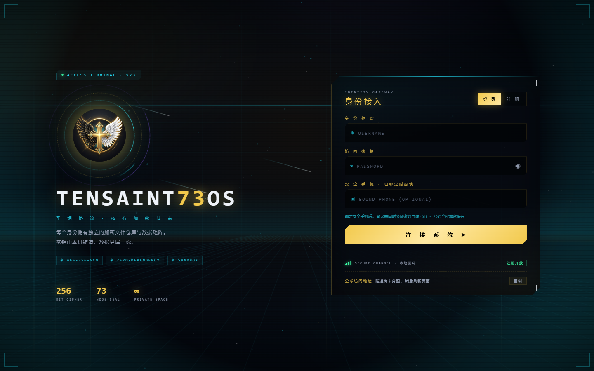<br><sub><b>Login</b> — password plus optional bound-phone second factor.</sub></td>
    <td width="50%">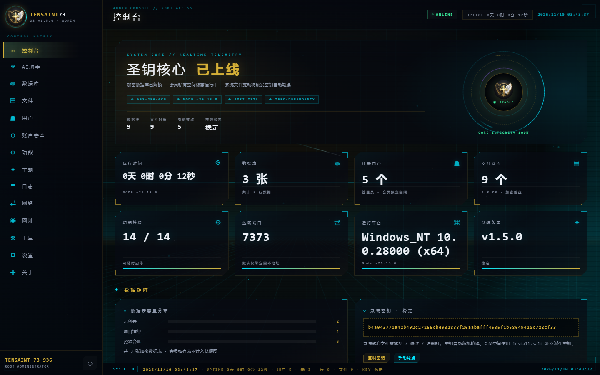<br><sub><b>Admin console</b> — encrypted system database unlocked, live telemetry.</sub></td>
  </tr>
  <tr>
    <td>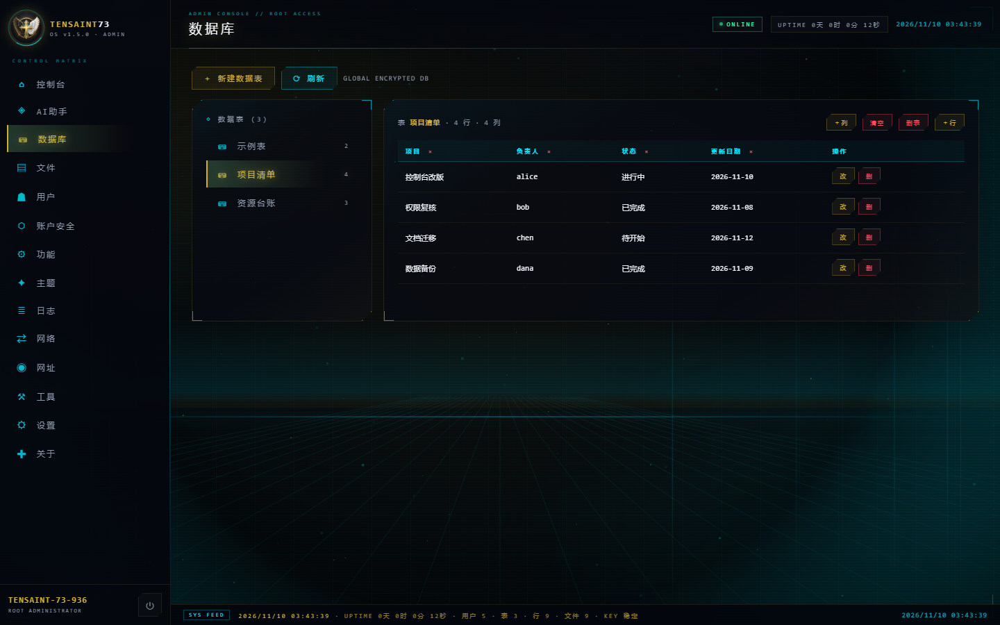<br><sub><b>Global database</b> — the sole administrator browses the unlocked system store.</sub></td>
    <td>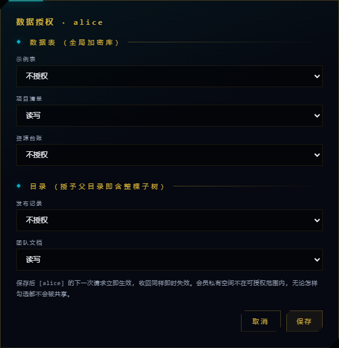<br><sub><b>Grant dialog</b> — per-table and per-directory read / read-write levels.</sub></td>
  </tr>
  <tr>
    <td>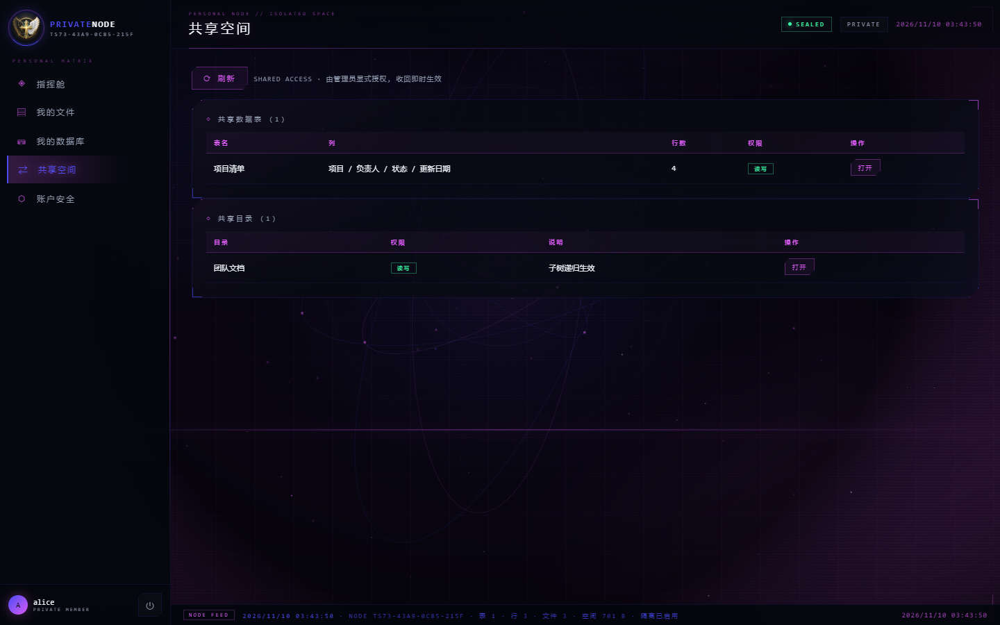<br><sub><b>Shared space</b> — a member sees only the granted tables and directories.</sub></td>
    <td>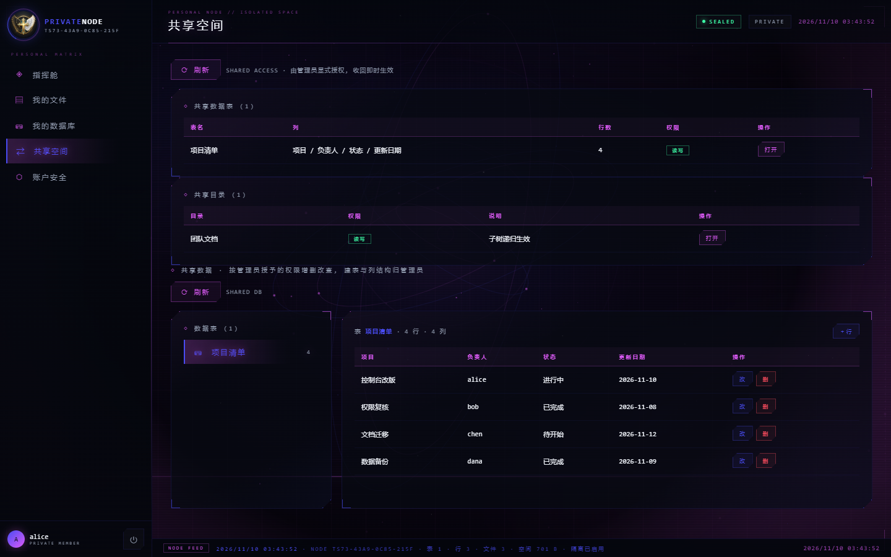<br><sub><b>Shared table</b> — row insert/edit/delete inside an <code>rw</code> grant; no DDL.</sub></td>
  </tr>
  <tr>
    <td>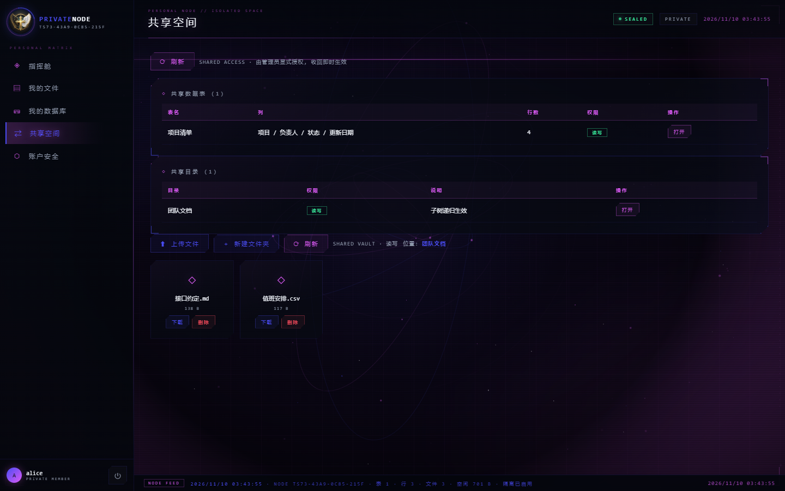<br><sub><b>Shared directory</b> — upload, mkdir, download and delete inside the granted subtree.</sub></td>
    <td>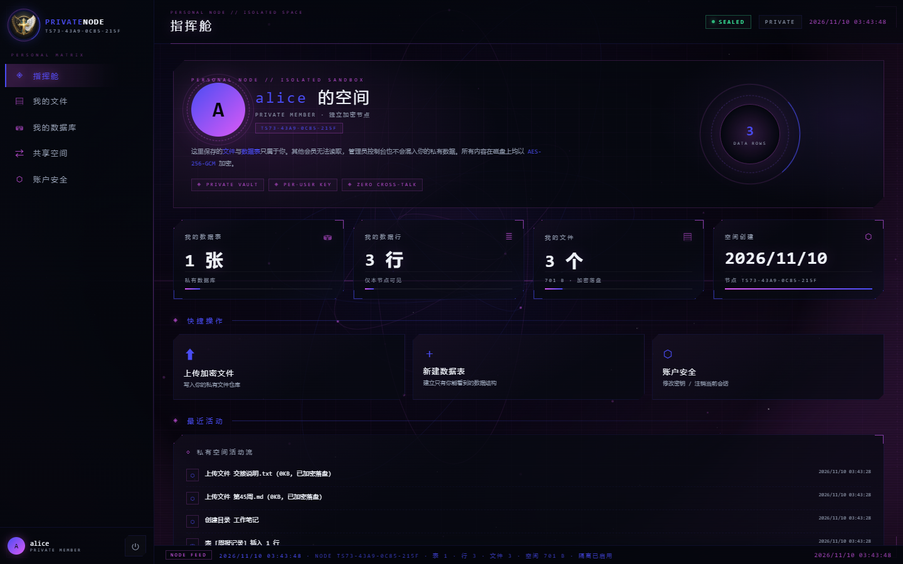<br><sub><b>Member space</b> — isolated per-user vault and workspace.</sub></td>
  </tr>
  <tr>
    <td>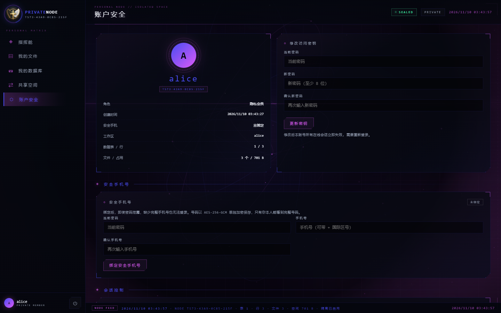<br><sub><b>Account security</b> — role summary, password rotation and phone-binding second factor.</sub></td>
    <td>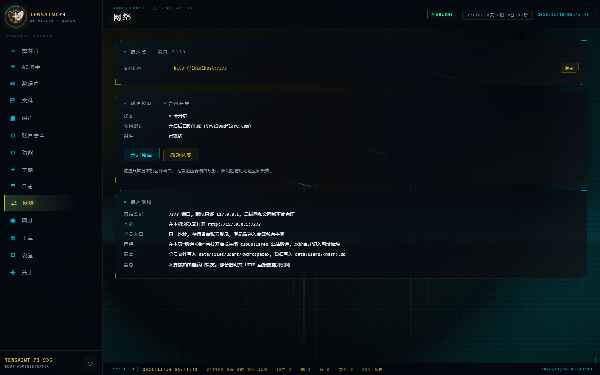<br><sub><b>Tunnel control</b> — administrator-only Cloudflare tunnel opened from the console; the public URL is issued on demand.</sub></td>
  </tr>
</table>

---

## 5. Security architecture

The request path, the trust boundary and the two inbound rules are drawn once,
in the figure below; the sections that follow add the details.

<div align="center">
  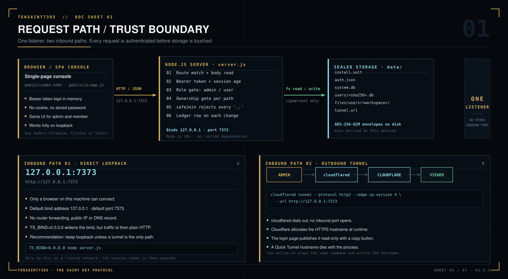
</div>

### 5.1 Trust boundary

The browser talks to a Node.js process on the same machine over loopback. The
host is the security perimeter: if the operating system is compromised, the
application cannot defend its data. Encryption protects **data at rest**, not a
machine that is already under an attacker's control.

There are only two network paths into the console:

1. `127.0.0.1:7373` (default), reachable only from the same machine.
2. An outbound Cloudflare tunnel initiated by an administrator. Cloudflare
   connects **out** to the internet; no inbound firewall port is opened.

### 5.2 Cryptography at rest

| Asset | Cipher / KDF | Key source | Notes |
|---|---|---|---|
| Auth vault (`auth.json`) | AES-256-GCM | `SHA-256("TenSaint73OS::" + install.salt)` | Entire user table is one encrypted envelope. |
| Login password | scrypt (N=16384, r=8, p=1, 64-byte output) | Random 16-byte salt per user | Only the hash is stored. |
| Phone number | AES-256-GCM | `HMAC-SHA256(installKey, "TenSaint73OS::phone-vault::v1")` | Domain-separated from the vault key. A scrypt hash is also stored for login verification. |
| System database (`system.db`) | AES-256-GCM envelope + scrypt KDF | Admin password + random salt | Locked until an administrator logs in. |
| User database (`users/*.db`) | AES-256-GCM | `SHA-256("TenSaint73OS::userdata::v1::" + install.salt)` | Independent of the admin password; members can work while the system DB is locked. |
| Uploaded files | AES-256-GCM (`TSF1` container) | scrypt(install.salt, `"TenSaint73OS::files::v1"`) | Sealed before `writeFileSync`. |
| Sessions | 24 random bytes, 12-hour sliding TTL | In memory | Restarting the server invalidates all sessions. |
| Owner key (`.tsowner`) | AES-256-GCM envelope + scrypt KDF | Owner passphrase | Contains no plaintext username, password hash or phone number outside the envelope. |

All encryption keys are generated locally. There is no project-operated key
server, account system or recovery service.

### 5.3 Roles and enforcement

| Capability | Supreme admin | Member |
|---|:---:|:---:|
| Register through the public page | — | Yes |
| Login with password | Yes | Yes |
| Login with password + bound phone | Yes | Yes |
| Open the admin console | Yes | No |
| See the global encrypted system database | Yes, every table | Only tables explicitly granted |
| Read a granted global directory | Yes, the whole tree | Only the granted subtree |
| Create/drop tables in own space | Yes (global) | Yes (own) |
| Read another member's private vault/files | No — blocked at every API layer, including the private subtree and password reset | No |
| Read another member's space summary | No — `/api/users/space` answers only the caller | No |
| Manage users and feature grants | Yes | No |
| Start/stop the public tunnel | Yes | No |
| Change own password | Yes | Yes |
| Bind/unbind own phone | Yes | Yes |
| Permanently delete own account and its data | Yes | Yes |

Server-side enforcement is two allowlists — `MEMBER_ROUTES` for the member's own
space and the narrower `SHARED_ROUTES` for grant-gated global resources — plus an
administrator check in `handleApi`. A member request to any other route receives
`403` before the handler runs. The client UI is not the security boundary.

The admin row is singular. `auth.addUser` creates members only, and
`POST /api/users/create` rejects `role: "admin"` with `400` before touching the
vault. The console dialog and the AI assistant have no role field. The only way
to establish the supreme administrator is to import an owner key (§7.3); the
import itself refuses to run when an admin already exists.

### 5.4 Phone second factor

When a phone is bound:

- The login request must contain the same normalized phone number.
- The number is encrypted with a key derived separately from the auth-vault key.
- A scrypt hash is kept for constant-time verification.
- Administrator user lists expose only **bound / unbound**, never the number.
- Only the owner's own authenticated session can retrieve the full number.
- A phone change or unbind requires the current password **and** the current
  phone, and revokes other sessions.

This is a strong second factor against password theft, but it is not a hardware
security key. Anyone who controls both the password and the bound SIM can log in.

### 5.5 Per-user isolation

<div align="center">
  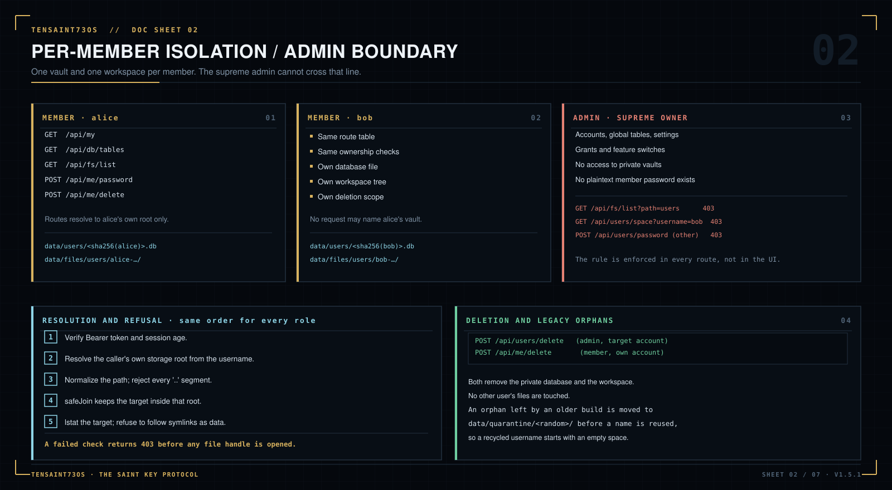
</div>

Each member gets:

- `data/users/<sha256(username)>.db` — a separate AES-256-GCM database.
- `data/files/users/<workspace>/` — a separate encrypted workspace.

The API resolves the caller's own root on every request and refuses paths that
escape it. Members cannot enumerate or open another member's store through the
console.

**The administrator is not an exception.** The global file manager can see the
owner's global repository, but the `users` subtree is removed from its root
listing and every `/api/fs/*` call whose normalized target begins with `users`
is answered with `403` — including disguised spellings such as `users/../users`
and, on case-insensitive filesystems, `USERS` or `users.`. The private database
files are never exposed through the global database browser, `/api/users/space`
returns data only when the requested name equals the caller, and
`/api/users/password` refuses any target other than the caller. In other words,
the supreme administrator has no platform route that reads, resets a password
to reach, or re-registers a name to inherit another member's private data.

**Deleting an account removes its private data.** `POST /api/users/delete` and
the member's own `POST /api/me/delete` both destroy
`data/users/<sha256(username)>.db` and `data/files/users/<workspace>/`. If an
older build left an orphan directory behind, account creation first moves it to
`data/quarantine/` under a random name, so a new account starting with the same
username gets an empty space rather than somebody else's files.

**Important boundary:** the Node process holds the installation keys and runs on
the owner's machine. A malicious host operator could instrument the process or
read its memory. The isolation is an application/API guarantee plus encryption
at rest; it is not a cryptographic guarantee against the machine owner. Run this
software only on hardware you trust.

### 5.6 Data grants and the shared view

<div align="center">
  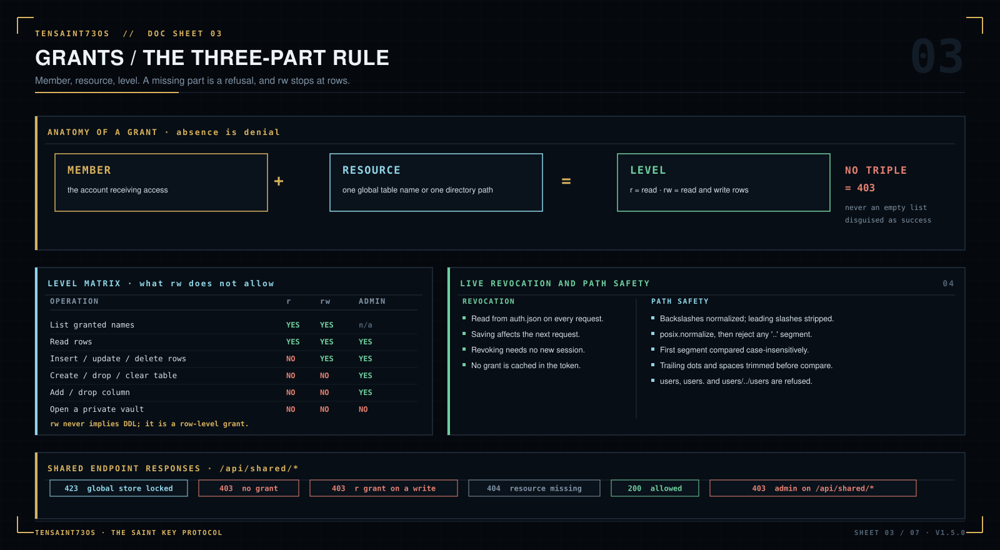
</div>

Isolation (§5.5) answers “who can see this member's data”. Grants answer the
opposite direction: **which global resources may a member see**. Both rules run
at the same time, and neither one relaxes the other.

**The model.** A grant is a triple — member, resource, level. A resource is
either one global table name or one directory path relative to the encrypted
file root (`""` means the root itself). A level is `r` or `rw`. Absence is
denial: there is no wildcard, no “all tables” switch and no implicit read. The
grant map lives inside the encrypted auth vault, so it is covered by the same
envelope as the user table and is restored with `auth.json`.

**What the member receives.** `GET /api/shared` intersects the table grants with
what actually exists at that moment, so a deleted table leaves no stale entry.
Directory entries come straight from the grant map (a granted folder may not
have been created yet); opening a missing one returns `404`. The member never
learns the name of an ungranted table or directory, because those names are
never sent to the browser. The private `users` root is excluded at every depth:
a grant that tries to name it is stripped when saved and ignored when read.

**Enforcement path.** Each `/api/shared/*` request normalizes the path, checks
the grant, and only then touches the store. Administrator accounts are refused
on this surface with `403` — the shared view exists to narrow a member's
reach, not to give the owner a second, weaker console. Table calls return:

| Situation | Status |
|---|---|
| Global store locked | `423 Locked` |
| No grant for the table | `403` |
| Grant is `r` but the call writes | `403` |
| Table does not exist | `404` |
| Grant matches | `200` |

**Path safety.** Input is backslash-normalized and stripped of leading slashes
before `path.posix.normalize` runs; any path that still contains a `..` segment
is rejected. This matters because a first-segment-only check would accept
`docs/../users/alice`, which normalizes into the private root. The first segment
is compared case-insensitively after trailing dots and spaces are removed,
because Windows and macOS resolve `USERS` and `users.` to the same directory.
Upload and mkdir names are sanitized, and `.` / `..` are refused. Directory
listings use `lstat`, flag symbolic links, and refuse to treat a link as a file
or folder. The same rule runs on the administrator's `/api/fs/*` routes, so the
private subtree is not reachable even with a crafted global path.

**Scope of `rw`.** An `rw` table grant enables row insert, update and delete.
It does **not** enable create/drop/clear or column changes; those routes do not
exist under `/api/shared`, so a crafted request cannot reach DDL. An `rw`
directory grant enables upload, mkdir and delete of entries beneath it; the
global file root itself is refused as a delete target.

**Live revocation.** Grants are read from the vault on every request. Saving the
dialog changes the member's next request; revoking is equally immediate. No
session invalidation is needed because no grant is cached in the session token.

**Locked store.** The global database key is derived from the admin password.
While it is locked, table and file calls under `/api/shared` return `423`, and
the member panel shows a locked notice instead of an empty list. The distinction
matters: “nothing was granted” and “the owner has not unlocked yet” are different
states and must not be displayed as the same thing.

### 5.7 Sessions and brute-force resistance

- Tokens are 24 random bytes, hexadecimal encoded.
- Sessions expire after an idle window that slides forward on every request; the
  exact lifetime is listed in §8.
- Login failures are counted per client IP; the threshold and lock duration are
  listed in §8.
- Password changes, phone changes and deletions revoke the affected sessions.
- When the server is behind the tunnel, client IPs are taken from
  `X-Forwarded-For` only because the origin socket is loopback and the proxy is
  trusted. `TS_TRUST_PROXY=0` disables that behavior.

### 5.8 File manifest and key rotation

On boot, the server hashes the application files (root files, `core/`, `public/`)
and compares them with `data/manifest.json`. If files were moved, added, removed
or modified, it rotates the in-memory system key value and records a new
baseline. This is a tamper signal for the console; it is **not** a code-signing
or anti-malware system.

### 5.9 What the model does not protect

Be explicit about the limits:

- A compromised OS, keylogger or malicious browser extension can capture
  credentials before encryption is applied.
- An attacker with root can access process memory and derived keys.
- Cloudflare terminates TLS at its edge. It can observe traffic in transit even
  though data on disk is encrypted.
- A weak admin password undermines the system database envelope. Use a long,
  unique password and keep the bound phone private.
- A copied `data/` folder that includes `install.salt` plus the application can
  be decrypted by someone who also knows the passwords. Treat backups as secrets.
- The quick tunnel is convenient, not a production SLA. It is rate-limited,
  ephemeral and visible to anyone who obtains the URL.

### 5.10 Owner key (`.tsowner`)

<div align="center">
  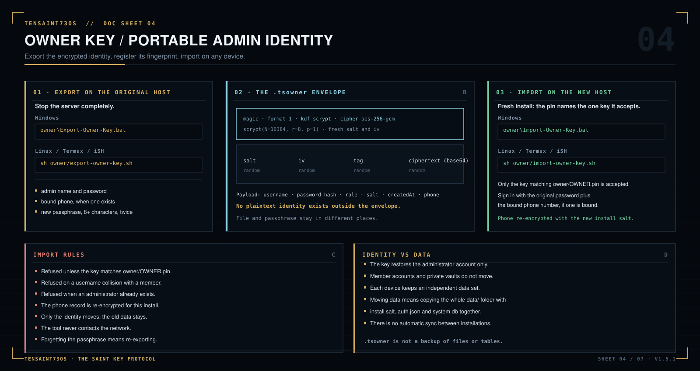
</div>

The owner key solves a specific problem: the public package cannot contain admin
credentials, yet the owner wants to sign in as supreme administrator on **any
machine of any supported platform**.

The `.tsowner` file is a portable, encrypted copy of the administrator identity:
username, password hash, role, creation time, salt and the bound phone record.
It is encrypted with a passphrase using AES-256-GCM and scrypt. The file contains
no usable plaintext identity. Importing it on a fresh installation writes the
admin into the new machine's auth vault and re-encrypts the phone under that
installation's key.

It does **not** migrate `system.db`, member databases, files or the old install
salt. Identity is portable; data remains per-device.

A `.tsowner` is accepted only when its identity fingerprint matches
`owner/OWNER.pin`. The pin is a SHA-256 over the key's username, password salt
and password hash — no password, phone number or plaintext. It belongs to the
program directory, not to a computer: register it once from the key you trust,
then every device running that build accepts exactly that key file and rejects
hand-made or foreign keys. A build without a pin refuses all imports. The pin is
not a secret and is meant to be committed with the build; the `.tsowner` and its
passphrase never are.

---

## 6. Four platforms, one core

<div align="center">
  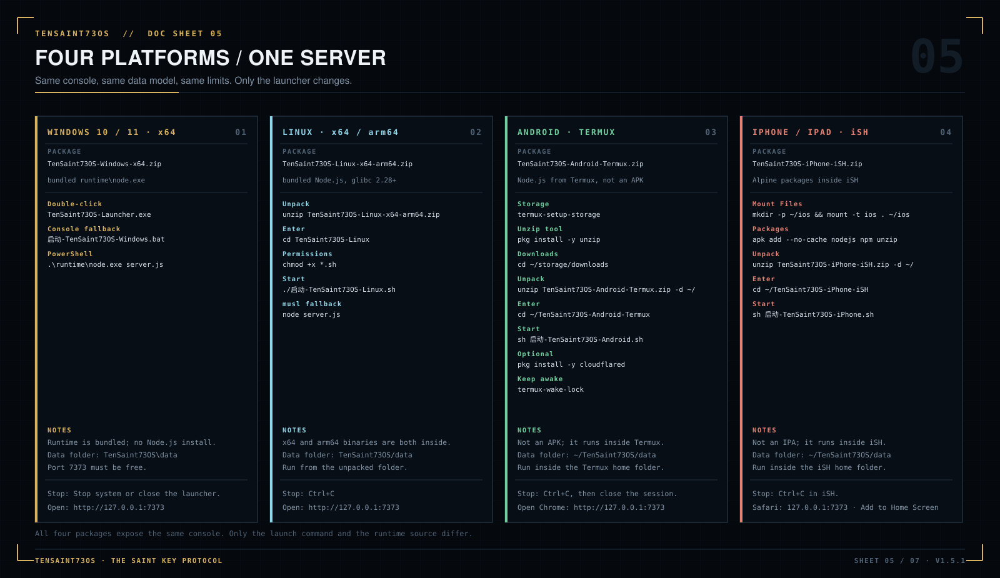
</div>

| | Windows | Linux | Android | iPhone / iPad |
|---|---|---|---|---|
| Package | `TenSaint73OS-Windows-x64.zip` | `TenSaint73OS-Linux-x64-arm64.zip` | `TenSaint73OS-Android-Termux.zip` | `TenSaint73OS-iPhone-iSH.zip` |
| Runtime | Node.js 24.18.0 **bundled** | Node.js 24.18.0 **bundled** (x64 + arm64) | Node.js installed by Termux | Node.js installed by iSH/Alpine |
| Launcher | `TenSaint73OS-Launcher.exe` | `启动-TenSaint73OS-Linux.sh` | `启动-TenSaint73OS-Android.sh` | `启动-TenSaint73OS-iPhone.sh` |
| UI | Default browser → `127.0.0.1:7373` | Browser | Chrome | Safari |
| Native app? | Desktop executable | Shell + browser | Not an APK | Not an IPA |
| Tunnel host | Recommended | Recommended | Good (keep awake) | Not recommended |
| Data location | `TenSaint73OS\data` | `TenSaint73OS/data` | `~/TenSaint73OS/data` | `~/TenSaint73OS/data` |

The **viewer can be any device**: once a tunnel is running, a Windows PC, Mac,
Linux laptop, Android phone, iPhone or iPad with internet can open the HTTPS
address. The four packages describe where the *server* runs, not who may connect.

### 6.1 Windows 10 / 11 (x64)

1. Unzip the whole archive to a normal folder. Do not run it inside the ZIP.
2. Double-click `TenSaint73OS-Launcher.exe`.
3. The launcher starts the bundled Node runtime, shows the live log and opens
   the console. Use **Open console** (打开界面) if the browser does not open automatically.
4. If SmartScreen appears: **More info → Run anyway**. The executable is
   unsigned; the source is in this repository.
5. Fallback: `启动-TenSaint73OS-Windows.bat` keeps a visible console.

The package bundles `runtime\node.exe`; Node.js does not need to be installed.
The service listens on `127.0.0.1:7373` only.

### 6.2 Linux (x64 / arm64)

```bash
unzip TenSaint73OS-Linux-x64-arm64.zip
cd TenSaint73OS-Linux
chmod +x *.sh
./启动-TenSaint73OS-Linux.sh
```

The launcher detects x86_64 or aarch64 and uses the matching bundled Node
binary. It requires glibc 2.28+ (Debian 10, Ubuntu 18.10, RHEL 8 or newer).
On musl/Alpine or older systems, install the distribution's Node.js 18+ and the
script falls back to `node` from `PATH`.

Optional application-menu entry:

```bash
./安装-Linux桌面图标.sh
```

### 6.3 Android (Termux)

This is a Termux application, not an APK.

1. Install **Termux** from F-Droid (the Play Store build is outdated).
2. Optional: install **Termux:Widget** and **Termux:Boot**.
3. In Termux:

```bash
termux-setup-storage
pkg install -y unzip
cd ~
unzip ~/storage/downloads/TenSaint73OS-Android-Termux.zip -d ~/
cd ~/TenSaint73OS-Android-Termux
sh 启动-TenSaint73OS-Android.sh
```

The first launch installs Node.js LTS through `pkg` (internet required once).
Then open Chrome at `http://127.0.0.1:7373`. Use **Add to Home screen** for an
app-like icon. Set Termux battery optimization to **Unrestricted** and acquire a
wake lock for long sessions. A desktop widget helper is included:

```bash
sh ~/TenSaint73OS-Android-Termux/安装-Termux桌面小部件.sh
```

For the in-console tunnel on Termux, use the console's **Install tunnel
component** (安装隧道组件) button.
`pkg install -y cloudflared` remains a manual fallback.

### 6.4 iPhone / iPad (iSH)

This is not an IPA. It runs inside **iSH**, the x86 Alpine emulator from the App
Store.

1. Install iSH from the App Store.
2. Put the ZIP where the Files app can see it, then in iSH:

```bash
mkdir -p ~/ios
mount -t ios . ~/ios      # choose the folder in the picker
cd ~/ios
unzip TenSaint73OS-iPhone-iSH.zip -d ~/
cd ~/TenSaint73OS-iPhone-iSH
sh 启动-TenSaint73OS-iPhone.sh
```

The first run installs `nodejs`, `npm` and `unzip` with `apk`. Open Safari at
`http://127.0.0.1:7373` and use **Share → Add to Home Screen**.

iOS suspends iSH when you switch to Safari. Data is not lost, but the server
pauses. Keep iSH in the foreground for active use; an optional keep-alive script
(`TenSaint73OS/ios-keepalive.sh`) exists but is battery-intensive and not
guaranteed. Because of this, **iSH is a demo/secondary node, not the recommended
always-on tunnel host**.

### 6.5 Why no native APK or IPA?

- A real IPA requires macOS, Xcode and an Apple signing identity. Cross-compiling
  a Node.js server + WebView into a signed IPA from Windows is not possible with
  this project's constraints.
- A native Android app would add a large toolchain and an APK signing pipeline,
  while Termux already provides a complete Linux userland with Node.js.
- The web console is the same on every platform, so there is one UI to secure
  and maintain instead of four native codebases.

---

## 7. Quick start

### 7.1 Default: member-only mode

A fresh public package has no admin. Start it, open the console, click
**Register** (注册) and create a member account. That account can:

- log in and log out,
- use its own encrypted database and file workspace,
- bind a phone number,
- permanently delete itself.

It cannot see the admin console, other members, the tunnel controls or the
global system database.

### 7.2 A fresh install has no administrator

The public package ships no administrator account, no bootstrap password and no
environment-variable shortcut. On a fresh installation the server starts in
member-only mode: people can register, sign in, use their own encrypted space,
bind a phone and delete themselves, but no member can obtain the `admin` role.

This is deliberate. The supreme administrator identity — username, password,
bound phone and role — exists only inside the encrypted `.tsowner` file held by
its owner. The program never generates those credentials and never writes them
into the download or into `data/`. To bring the administrator onto this machine,
register that key's fingerprint in `owner/OWNER.pin` and import it as described
in §7.3. There is no other path: the console, the HTTP API, the AI assistant and
`auth.addUser` create members only, the import refuses a key that does not match
the registered pin, and it refuses to run when an administrator already exists.

If an installation is upgraded in place and its `data/auth.json` already
contains the administrator, that account keeps working with the same password
and phone; no import is needed.

> The admin password is also the key material for the system database. If you
> forget it, `system.db` cannot be decrypted. Store it in a password manager and
> keep an offline backup.

### 7.3 Restore the supreme admin on any platform with `.tsowner`

**Step 1 — export on the original device.** Fully stop the server, then run:

- Windows: `owner\Export-Owner-Key.bat`
- Linux / Termux / iSH: `sh owner/export-owner-key.sh`

You will be asked for the admin password, the bound phone (if any), and a new
owner-key passphrase (at least 8 characters). The tool writes an encrypted
`.tsowner` file. Keep it separate from the passphrase.

**Step 2 — register the owner identity once.** While `owner/OWNER.pin` is absent
or empty, every import is refused. Run this with the key you intend to own the
deployment:

- Windows: `owner\Fingerprint-Owner-Key.bat "C:\path\to\your.tsowner"`
- Linux / Termux / iSH: `sh owner/fingerprint-owner-key.sh "/path/to/your.tsowner"`
- Any shell with Node.js: `node owner/owner-vault.js fingerprint "/path/to/your.tsowner" --write`

The command writes `OWNER_PIN=<64 hex>` into `owner/OWNER.pin`. The pin is
portable and contains no credentials. Commit it with the build (or copy the
program folder as-is) so the same key is accepted on every device; a different
key — including a self-made one with valid JSON — cannot match it. An existing,
different pin is never overwritten.

**Step 3 — import on any device.** With the registered pin present and no admin
account on the target installation, run:

- Windows: `owner\Import-Owner-Key.bat`
- Linux / Termux / iSH: `sh owner/import-owner-key.sh`

Enter the `.tsowner` path and passphrase. The identity (including the encrypted
phone) is written into the new installation. Log in with the original password
plus the bound phone number. Member accounts created on the old device do not
come along, and the old device's databases are not copied.

### 7.4 First login and second factor

- Admin: username + password; if a phone is bound, add the exact phone number.
- Member: same rules.
- Public registration: username 2–20 characters, password at least 8 characters.
- After login, administrators land in the admin console; members land in their
  private space.

### 7.5 Stop the service

- Windows launcher: **Stop system** (停止系统) or close the launcher window.
- Terminal: `Ctrl+C`.
- Android widget/script sessions: close the Termux session after `Ctrl+C`.
- Stopping the server also stops an in-console tunnel and invalidates sessions.

---

## 8. Operating limits reference

Every value in this chapter is enforced by the server, not by the browser. The
form validates early for convenience; `server.js` repeats the check and returns
a status code. Truncation, where it happens, is marked explicitly.

### 8.1 Accounts, sessions and access

| Item | Limit | At the limit |
|---|---|---|
| Username | 2–20 characters; first character a letter, digit, Chinese character or `_`; later characters may add `.` and `-` | Registration or account creation returns `400` |
| Password | 8–128 characters | `400`; no plaintext password is stored |
| Member accounts | 200 accounts with role `user` per installation | Registration returns `400` |
| Supreme admin | Exactly one account with role `admin`; established only by importing the `.tsowner` whose fingerprint matches `owner/OWNER.pin` | A second admin is refused — `POST /api/users/create` returns `400`, `auth.addUser` creates members only, AI refuses, import refuses when an admin exists; a key without a registered or matching pin is refused |
| Public registration | 8 accepted attempts per client IP per rolling hour, when enabled | `429`; the counter resets after the hour |
| Login lockout | 5 consecutive failures per client IP | `429` plus a 60-second lock; a successful login clears the counter |
| Session lifetime | 12 hours, sliding forward on each authenticated request | An expired token is deleted and returns `401` |
| Session storage | Memory only | Restarting the server signs every user out |
| Phone factor | Exact match against the bound number | `401`; the failure counts toward the IP lockout |
| Session revocation | Password change, phone change, phone removal or account deletion | Every other token for that account is destroyed immediately |

### 8.2 Member databases and workspaces

| Item | Limit | At the limit |
|---|---|---|
| Tables per member | 60 | `400` |
| Rows per table | 5,000 | `400` |
| Columns per table | 32 | `400` |
| Table name | 40 characters | `400` |
| Column name | 30 characters | `400` |
| Cell text | 2,000 characters | Longer text is truncated on insert and update; no error |
| Activity feed | 60 entries | The oldest entry is dropped |
| Duplicate names | Table and column names must be unique | `400` |
| Empty names | Table and column names must be non-empty | `400` |
| Bytes per member | No separate byte quota | Bounded by free disk space and the request-body cap |

Each member owns one database file and one workspace directory. Both are created
on registration or first login and are removed with the account.

### 8.3 Global store and URL board

| Item | Limit | At the limit |
|---|---|---|
| Global tables and rows | No fixed cap in `core/store.js` | Bounded by memory and the 50 MB request body |
| System log | 1,000 entries | Oldest entries are dropped |
| URL board | 200 entries | The oldest non-current entry is removed |
| URL name / note | 60 / 200 characters | Longer values are truncated |
| Grants per member | No fixed cap | Every granted name must still pass path safety |

The global store belongs to the administrator. Member databases are separate
files, so these values do not constrain a member's own space.

### 8.4 Transport, runtime and tunnel

| Item | Limit | At the limit |
|---|---|---|
| Request body | 50 MB | The connection is destroyed before routing; no partial file is written |
| Single upload | About 37 MB of raw file | Base64 expands by 4/3 inside the JSON body |
| Bind address | `127.0.0.1` by default | `TS_BIND=0.0.0.0` widens it; traffic is then plain HTTP |
| Port | 7373 by default | `TS_PORT` overrides it; the process stops if the port is already taken |
| Runtime | Node.js 18 or newer | The bundles ship Node.js 24.18.0 where the platform allows it |
| Quick Tunnel | One hostname per running `cloudflared` process | A restart allocates a different hostname; there is no SLA |
| Tunnel lifetime | Bound to the process | Stopping the tunnel clears the live value immediately |

### 8.5 How a limit is reported

- `400` — validation failure: length, duplicate or empty names, malformed input.
- `401` — missing, expired or revoked token; wrong password; wrong phone factor.
- `403` — role or grant refusal, admin access to a private vault, disabled module.
- `404` — the requested table, directory or file does not exist.
- `423` — the global store is locked; members may still use their own spaces.
- `429` — login lockout or the registration rate limit. A disabled registration
  switch returns `403` instead.
- Truncation — cell text, log entries, activity entries and URL notes are cut
  silently to their caps.
- Connection close — a body above 50 MB is refused before routing, so nothing is
  written to disk.

These are the defaults for v1.5.0. The constants live in `core/auth.js`
(`SESSION_TTL`), `core/userstore.js` (`MAX_*`), `core/store.js` (log and URL
caps) and `server.js` (body cap and rate limit).

---

## 9. Public tunnel

### 9.1 What it does

An administrator can start an outbound **Cloudflare Quick Tunnel** from the
console (**Network Matrix → Tunnel Control**, 网络矩阵 → 隧道控制) or with `run-online.sh`. The server spawns
`cloudflared`, which connects out to Cloudflare and prints a freshly allocated
HTTPS hostname. No address is fixed in this manual: the value belongs to the
running process and changes every time the tunnel restarts.

The URL is written to the URL board and `data/tunnel.url`. It works globally:
any device with internet can open it and reach the login page. No router port
forwarding, public IP or DNS record is required.

**The login page publishes the address.** A read-only line under the login form
shows the current tunnel URL whenever the server has one, with a copy button.
It is rendered from `GET /api/access`, which only reads the already-generated
value (`tunnelState`, `data/public_url.txt`, `data/tunnel.url`, or
`TS_PUBLIC_URL`). The tunnel mechanism itself is unchanged: the URL is still
created by `cloudflared`, still random, and still expires when the tunnel stops.
`GET /api/access` contains no account, file or database information.

<div align="center">
  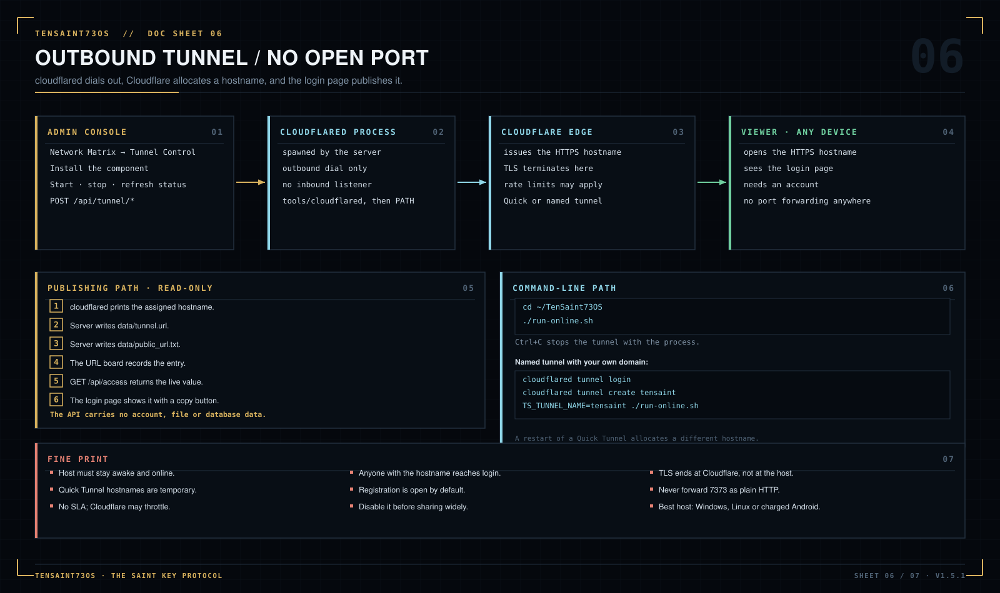
</div>

### 9.2 The fine print

- **Host must stay online.** If the computer sleeps, Termux is killed, iSH is
  suspended, or the server exits, the URL stops working.
- The URL is ephemeral. A restart creates a new hostname. Only a named
  Cloudflare tunnel with your own domain gives a stable hostname.
- **No SLA.** Quick Tunnels are a convenience feature. Cloudflare may rate-limit,
  throttle or change them.
- **Anyone with the URL can reach the login page.** They still need an account;
  the public build cannot create an admin. Registration is open by default, so
  disable it in the admin settings before sharing the URL broadly.
- **TLS terminates at Cloudflare.** Data on disk is encrypted, but Cloudflare can
  observe traffic at its edge. Do not treat this as end-to-end encryption.
- **Host recommendations:** Windows, Linux or a charged Android/Termux device
  with battery optimization disabled. iPhone/iSH is not a reliable tunnel host.
- **Stop the tunnel when done.** The console's stop button ends the child process
  and the URL immediately.

### 9.3 Update notice and data continuity

The login page asks `GET /api/update` after the boot animation. The server
compares its own `VERSION` with the newest published GitHub release — one HTTPS
request to the public releases API, cached for an hour, six-second timeout, no
account data, and a silent failure when offline. Only when the official release
is newer does the notice appear, and only while this machine still holds a
previous deployment: a remembered account (`ts73_last_user`), or `data_present:
true` from the server (an existing `system.db`, per-member databases, member
workspaces, or a recorded tunnel URL). A current build is therefore never asked
to update itself. Closing the notice hides it for that session only; the next
open shows it again. Nothing is written to `localStorage` as an acknowledgement,
so no browser state can permanently silence it. A brand-new install with no data
and no remembered account is not interrupted at all. The notice links to
<https://github.com/IAMMEZSH/TenSaint73OS/releases/latest> and states the
continuity guarantee:

- Application files may be replaced; `data/` (auth vault, system database,
  per-member databases and encrypted workspaces) is untouched. Extract the new
  build over the same directory, or copy the old `data/` directory into the new
  one before the first start.
- A member signs in with the same account after the update and reconnects to the
  same workspace automatically — no export, import or path remapping. Sessions
  are in memory by design, so the passphrase is asked again after a restart.
- The tunnel mechanism is unchanged: `cloudflared` still allocates a fresh
  Cloudflare Quick Tunnel hostname, and the login page publishes whatever URL
  the current process obtained. A new hostname after a restart is expected.
- Replacing program files changes the integrity manifest, so the **displayed**
  system key is rotated and the console says so. That key is a fingerprint, not
  the data key: `install.salt`, `auth.json`, `system.db`, per-member databases
  and workspaces keep their existing encryption and remain readable.
- Dismissing the notice changes nothing on disk and stores no browser marker;
  the next open shows it again while the old deployment is still present.
- A copy that predates this notice has no update channel and cannot be modified
  from the outside; it never contacts this repository on its own. Opening a
  current build in the same directory is the update step, and the old data is
  read as-is.

The version shown in the sidebar and the cache-busting query on `app.js` and
`style.css` use the server version, so a stale browser cache does not silently
mix two UI builds.

### 9.4 In-console installation

The admin console's **Install tunnel component** (安装隧道组件) button
(`POST /api/tunnel/install`) is a
one-click flow. It selects the matching `cloudflared` asset for the current
platform (Windows, Linux, Android/Termux, iPhone/iSH, macOS), downloads it from
Cloudflare's official release channel, and falls back to public mirrors when
GitHub is unreachable. Large binaries are fetched with parallel range requests,
so a single throttled connection cannot stall the install. On Windows the
Authenticode signature is verified; every platform then runs
`cloudflared --version` as a self-test. When installation succeeds, the console
starts the tunnel immediately and polls until Cloudflare returns the allocated
hostname.

The server starts quick tunnels with `--protocol http2 --edge-ip-version 4`
because many networks block UDP/QUIC. `run-online.sh` uses the same flags and
prefers `tools/cloudflared` before any system-wide binary.

If the download is blocked on your network, install cloudflared manually:

```bash
pkg install -y cloudflared       # Termux
```

On iSH the installer fetches the linux-386 build and self-tests it. If the iSH
process cannot run the binary or iOS suspends it in the background, use a
desktop host and open its tunnel URL from the iPhone.

After replacing program files, fully exit and restart the server so the browser
loads the new `public/js/app.js`.

### 9.5 Named tunnel (optional, stable URL)

If you own a domain on Cloudflare:

```bash
cloudflared tunnel login
cloudflared tunnel create tensaint
```

Place the credentials in `data/tunnel.json` and a `data/tunnel.yml` with your
hostname mapped to `http://localhost:7373`. Start with:

```bash
TS_TUNNEL_NAME=tensaint TS_PUBLIC_URL=https://your.domain ./run-online.sh
```

Do not expose port 7373 directly. Plain HTTP would send passwords in the clear.

---

## 10. Configuration

### 10.1 Environment variables

| Variable | Default | Purpose |
|---|---|---|
| `TS_PORT` | `7373` | HTTP port. |
| `TS_BIND` | `127.0.0.1` | Listen address. Changing to `0.0.0.0` exposes plaintext HTTP to the LAN. |
| `TS_TRUST_PROXY` | auto | `1` trusts `X-Forwarded-For`; auto-on only for loopback binds. |
| `TS_PUBLIC_URL` | — | Optional public URL used by `run-online.sh` and shown in the console and on the login page when no tunnel file exists. |
| `TS_TUNNEL_NAME` | — | Named Cloudflare tunnel to run. |
| `TS_CLOUDFLARED` | — | Explicit path to a `cloudflared` binary. |
| `LAUNCH_OPEN` | — | `1` opens the browser on start (used by launchers). |
| `TS_BACKUP_PW` | — | Passphrase consumed by `backup.sh` (not stored). |

### 10.2 Runtime configuration file

`data/config.json` stores:

```json
{
  "port": 7373,
  "registration": true
}
```

- `registration`: administrators can toggle it from the console; when `false`,
  `/api/register` returns `403`.
- Port changes made through the console are persisted here and require a restart.

### 10.3 URLs

- Local console: `http://127.0.0.1:7373`
- API base: `http://127.0.0.1:7373/api`
- Public tunnel: the HTTPS hostname allocated by Cloudflare while the tunnel is
  running (also displayed read-only under the login form)
- LAN (only if you explicitly set `TS_BIND=0.0.0.0`): `http://<lan-ip>:7373`

---

## 11. Data, backup and recovery

### 11.1 Data layout

<div align="center">
  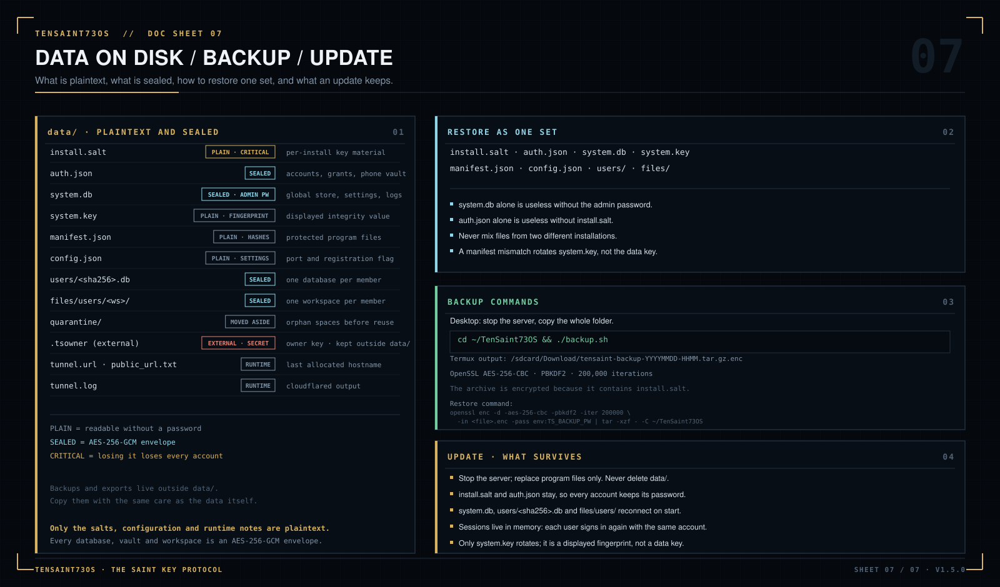
</div>

```text
TenSaint73OS/
├─ data/
│  ├─ install.salt              # install-unique key material (critical)
│  ├─ auth.json                 # AES-256-GCM auth vault
│  ├─ system.key                # system key value (rotates on file changes)
│  ├─ manifest.json             # application file hashes
│  ├─ config.json               # port / registration flags
│  ├─ system.db                 # encrypted global database (admin password)
│  ├─ users/
│  │  └─ <sha256(username)>.db  # one encrypted DB per member
│  ├─ files/
│  │  └─ users/<workspace>/     # encrypted member files
│  ├─ quarantine/                # orphaned private spaces moved aside on name reuse
│  ├─ tunnel.yml / tunnel.json  # optional named-tunnel config
│  ├─ tunnel.url / public_url.txt
│  └─ tunnel.log
├─ core/                        # crypto, auth, stores, util, AI helper
├─ public/                      # console UI (HTML/CSS/JS/assets)
├─ owner/                       # owner-key export, fingerprint and import tools
├─ server.js                    # zero-dependency server
├─ start.sh / run-online.sh
├─ backup.sh
└─ README.txt / README-iOS.txt / DEPLOY.txt
```

### 11.2 Back up

**Desktop (Windows/Linux):** stop the server, then copy the entire
`TenSaint73OS` folder to an encrypted disk or encrypted archive.

**Termux:**

```bash
cd ~/TenSaint73OS
./backup.sh
```

This creates `/sdcard/Download/tensaint-backup-YYYYMMDD-HHMM.tar.gz.enc` using
OpenSSL AES-256-CBC with PBKDF2 (200,000 iterations). The archive is encrypted
again because it contains `install.salt`, which is the key to the rest of the
data.

**iSH:** stop the server and copy the `TenSaint73OS/data` folder into the Files
app, or create a tar archive inside iSH and move it out.

### 11.3 Restore

Restore **everything together**:

- `install.salt`
- `auth.json`
- `system.db`
- `system.key`
- `manifest.json`
- `config.json`
- `users/`
- `files/`

`system.db` alone is useless without the admin password; `auth.json` alone is
useless without `install.salt`; user databases are useless without the install
salt. Do not mix files from two different installations.

For a `backup.sh` archive:

```bash
export TS_BACKUP_PW='the-backup-passphrase'
openssl enc -d -aes-256-cbc -pbkdf2 -iter 200000 \
  -in tensaint-backup-YYYYMMDD-HHMM.tar.gz.enc -pass env:TS_BACKUP_PW \
  | tar -xzf - -C ~/TenSaint73OS
```

### 11.4 Move to another machine

- To move the **data**, copy the complete `data/` plus the application files and
  keep the same admin password. The install salt must travel with the data.
- To move only the **admin identity**, use `.tsowner`. The new machine starts with
  empty data and its own member accounts.
- Copying `data/` without the application manifest may rotate the system key on
  first boot (a tamper signal). Keep a backup before experimenting.

---

## 12. Project structure

```text
TenSaint73OS/                 # this repository
├─ server.js                  # HTTP server, routes, tunnel
├─ core/
│  ├─ auth.js                 # users, sessions, phone vault, rate limits
│  ├─ crypto-util.js          # scrypt hashing, AES-256-GCM envelopes
│  ├─ store.js                # encrypted system database
│  ├─ userstore.js            # per-user encrypted database
│  ├─ ai.js                   # optional local assistant helper
│  └─ util.js                 # filesystem/JSON helpers
├─ public/
│  ├─ index.html              # console shell
│  ├─ css/style.css
│  ├─ js/app.js
│  ├─ icons/                  # PWA icons
│  ├─ logo.png
│  └─ manifest.webmanifest
├─ owner/
│  ├─ owner-vault.js          # portable admin identity tool
│  ├─ OWNER.pin.example       # published pin template (real pin is local/committed)
│  ├─ Export-Owner-Key.bat
│  ├─ Import-Owner-Key.bat
│  ├─ Fingerprint-Owner-Key.bat
│  ├─ export-owner-key.sh
│  ├─ import-owner-key.sh
│  ├─ fingerprint-owner-key.sh
│  └─ README.txt
├─ screenshots/               # sanitized demo screenshots
├─ docs/                      # seven mechanism diagrams used by this README
├─ start.sh / run-online.sh / backup.sh
├─ ios-install.sh / ios-start.sh / ios-keepalive.sh
├─ README.txt / README-iOS.txt / DEPLOY.txt
└─ package.json               # name, version, start script
```

Release ZIPs add the platform launchers and, for Windows/Linux, a `runtime/`
folder with the Node.js binary. The Git repository intentionally excludes
binaries and real data.

---

## 13. API appendix

All authenticated requests use:

```http
Authorization: Bearer <session-token>
Content-Type: application/json
```

### 13.1 Public endpoints

| Method | Path | Purpose |
|---|---|---|
| `GET` | `/api/state` | Version, current role, registration flag, lock state. |
| `GET` | `/api/theme` | Public theme defaults. |
| `POST` | `/api/register` | Create a member account. Always role `user`. |
| `POST` | `/api/login` | Password + optional bound phone. Returns a token. |
| `POST` | `/api/logout` | Destroy the bearer token. |
| `GET` | `/api/update` | Running version, the newest official release tag, `update_available` (true only when that tag is newer), official site and releases URL, `data_present` (whether this installation already holds encrypted data), data-continuity flags. No account data. |
| `GET` | `/api/access` | Running version and the already-generated tunnel URL (empty until one exists). No account data. |

### 13.2 Member endpoints

| Method | Path | Purpose |
|---|---|---|
| `GET` | `/api/my` | Own profile and space summary. |
| `POST` | `/api/me/password` | Change own password; revokes other sessions. |
| `GET` | `/api/me/phone` | Read own decrypted phone (self only). |
| `POST` | `/api/me/phone` | Bind or replace phone. |
| `POST` | `/api/me/phone/unbind` | Unbind with password + current phone. |
| `POST` | `/api/me/delete` | Permanently delete own account, DB and files. |
| `GET` | `/api/db/tables` | List tables in own store. |
| `POST` | `/api/db/create` | Create a table. |
| `POST` | `/api/db/drop` | Drop a table. |
| `GET` | `/api/db/table` | Read rows. |
| `POST` | `/api/db/insert` | Insert a row. |
| `POST` | `/api/db/update` | Update rows. |
| `POST` | `/api/db/delete` | Delete rows. |
| `POST` | `/api/db/clear` | Clear a table. |
| `POST` | `/api/db/addcol` | Add a column. |
| `POST` | `/api/db/delcol` | Delete a column. |
| `GET` | `/api/fs/list` | List own encrypted workspace. |
| `POST` | `/api/fs/mkdir` | Create a directory. |
| `POST` | `/api/fs/upload` | Upload base64 data; sealed before write. |
| `GET` | `/api/fs/download` | Decrypt and download a file. |
| `POST` | `/api/fs/delete` | Delete a file or directory. |

Member quotas, the request-body cap and the exact failure codes are listed in
[§8](#8-operating-limits-reference). Uploads are base64-encoded inside that
body, so the raw file is smaller than the body cap.

### 13.3 Shared endpoints (grant-gated)

These paths serve a member only, and only what the owner has granted. The owner
receives `403` here; the admin console uses the global routes instead.

| Method | Path | Grant required |
|---|---|---|
| `GET` | `/api/shared` | Any; returns granted tables, granted directories and the lock flag. |
| `GET` | `/api/shared/db/tables` | None; lists only tables present in the member's grant map. |
| `GET` | `/api/shared/db/table` | `r` or `rw` on the table. |
| `POST` | `/api/shared/db/insert` | `rw` on the table. |
| `POST` | `/api/shared/db/update` | `rw` on the table. |
| `POST` | `/api/shared/db/delete` | `rw` on the table. |
| `GET` | `/api/shared/fs/list` | `r` or `rw` on the directory or an ancestor. |
| `GET` | `/api/shared/fs/download` | `r` or `rw` on the file's directory chain. |
| `POST` | `/api/shared/fs/upload` | `rw` on the target directory chain. |
| `POST` | `/api/shared/fs/mkdir` | `rw` on the target directory chain. |
| `POST` | `/api/shared/fs/delete` | `rw` on the item's directory chain; the granted root is protected. |

Status codes: `423` while the global store is locked, `403` when the grant is
missing or read-only, `404` when the granted resource no longer exists, `400` on
an illegal path or name. Grants are re-read per request, so a change applies to
the next call.

### 13.4 Administrator endpoints

Administrators can call all member endpoints (against the global store/workspace).
The owner-only groups below are additional. The `/api/shared/*` surface is
member-only and returns `403` to an administrator by design. The two user
routes marked **self only** answer `403` when the requested username is not the
caller, so the console has no way to inspect another member's space summary or
reset their password.

| Group | Representative paths |
|---|---|
| Overview | `GET /api/overview` |
| Users | `GET /api/users`, `POST /api/users/create` (members only; `role: "admin"` returns `400`), `POST /api/users/delete`, `GET /api/users/space` (self only), `POST /api/users/password` (self only), `GET /api/grants?username=`, `POST /api/grants/set` |
| Features | `GET /api/features`, `POST /api/features/toggle`, `POST /api/features/add`, `POST /api/features/remove` |
| Theme | `POST /api/theme/set`, `POST /api/theme/reset` |
| Logs | `GET /api/logs`, `POST /api/logs/clear` |
| Network | `GET /api/network` |
| Tunnel | `GET /api/tunnel/status`, `POST /api/tunnel/start`, `POST /api/tunnel/stop`, `POST /api/tunnel/install` |
| URL board | `GET /api/urls`, `POST /api/urls/add`, `POST /api/urls/delete`, `POST /api/urls/current`, `POST /api/urls/clear` |
| Settings | `POST /api/settings/port`, `POST /api/settings/registration` |
| System | `POST /api/system/restart`, `POST /api/system/lock`, `POST /api/key/rotate` |
| Tools | `GET /api/tools/random`, `POST /api/tools/hash`, `POST /api/ai` |

A member calling an administrator path receives `403` with
`"权限不足: 该内容仅最高权限账号可见"` (“insufficient permission: this content is
visible to the highest-privilege account only”). An administrator calling an admin route before
the system database is unlocked receives an error until the admin logs in.

---

## 14. Run from source

Requirements: Node.js 18 or newer (24.x recommended). There is no install step.

```bash
git clone https://github.com/IAMMEZSH/TenSaint73OS.git
cd TenSaint73OS
node server.js
```

Open `http://127.0.0.1:7373`.

To bring the supreme administrator onto this checkout, register your owner key
(once, portable) and then import it:

```bash
# Linux / Termux / iSH — register the key this build will accept
sh owner/fingerprint-owner-key.sh "/path/to/your.tsowner"

# Linux / Termux / iSH — import it
sh owner/import-owner-key.sh
```

```bat
:: Windows
owner\Fingerprint-Owner-Key.bat "C:\path\to\your.tsowner"
owner\Import-Owner-Key.bat
```

Start the server afterwards and log in with the original admin password plus
the bound phone number. The program does not generate an administrator account,
and no environment variable can create one. `owner/OWNER.pin` may be committed
(it holds only the fingerprint); `*.tsowner`, `data/`, backups and runtime
binaries must never be.

> Never commit `data/`, `*.tsowner`, backups or runtime binaries.
> The repository's `.gitignore` already excludes them.

### Release packages

The GitHub Releases contain:

| File | Approx. size | Contents |
|---|---|---|
| `TenSaint73OS-Windows-x64.zip` | ~36 MB | Source + `runtime/node.exe` + GUI launcher |
| `TenSaint73OS-Linux-x64-arm64.zip` | ~87 MB | Source + Node x64/arm64 + launch scripts |
| `TenSaint73OS-Android-Termux.zip` | ~2.6 MB | Source + Termux scripts, no runtime |
| `TenSaint73OS-iPhone-iSH.zip` | ~2.6 MB | Source + iSH scripts, no runtime |
| `SHA256SUMS.txt` | small | SHA-256 of the four archives |

Verify a download:

```bash
# Linux / macOS / Termux / iSH
sha256sum TenSaint73OS-*.zip
# or
shasum -a 256 TenSaint73OS-*.zip
```

```powershell
# Windows PowerShell
Get-FileHash .\TenSaint73OS-Windows-x64.zip -Algorithm SHA256
```

Compare with `SHA256SUMS.txt` before launching. Builds are unsigned; SmartScreen
or Gatekeeper warnings are expected.

---

## 15. Hardening checklist

- [ ] Never place administrator credentials in the download; import the `.tsowner` key instead.
- [ ] Register the owner fingerprint (`owner/OWNER.pin`) so only that one key can be imported.
- [ ] Bind the admin phone number and keep the SIM/phone secure.
- [ ] Import/export the `.tsowner` key and store file + passphrase separately.
- [ ] Disable public registration before sharing a tunnel URL broadly.
- [ ] Keep the default loopback bind; do not port-forward 7373.
- [ ] Use the tunnel only when needed and stop it afterward.
- [ ] Keep the host OS, Node.js and cloudflared patched.
- [ ] Encrypt the disk (BitLocker, LUKS, FileVault, Android encryption).
- [ ] Keep offline backups of `data/` and test a restore.
- [ ] Do not run the server on a machine you do not trust.
- [ ] Rotate the admin password and re-export `.tsowner` after any suspected leak.
- [ ] Treat screenshots, logs and backups as sensitive.

---

## 16. FAQ

**Is TenSaint73OS a real operating system?**
No. It is an application-layer encrypted workspace with a console that feels
OS-like. It does not boot a machine.

**Can I install it as an APK or IPA?**
No. Android uses Termux; iPhone/iPad uses iSH. Native packages would require a
different toolchain and, for iOS, a Mac plus Apple signing.

**Can I log in as supreme admin from a public GitHub download on any platform?**
Only by importing your encrypted `.tsowner` key on that machine — never by
creating an account from the download. The public ZIP contains no credentials
and the program generates none. The build must first carry your
`owner/OWNER.pin` fingerprint; then that one key file works on any device, while
self-made keys are refused. Import once, then log in with the original password
and bound phone. Data does not sync.

**Why does the public build have no admin?**
Because shipping or generating one would give every downloader a path to the
same supreme credentials. The administrator identity lives outside the program
in an encrypted owner key; importing a key that matches the registered
fingerprint is the only way to establish it.

**Can another member read my database or files?**
Through the console, no. Each member has a separate encrypted database and
workspace, and the API enforces ownership. A grant can expose a *global* table
or directory, never another member's private store. The host operator, however,
controls the machine and the running process; see §5.9.

**Does the admin see my phone number?**
No. Admin lists show only bound/unbound. The number is encrypted with a
domain-separated key and only the owner's own session can retrieve it.

**Is registration open by default?**
Yes. The admin can disable it at runtime. Do that before sharing a public tunnel
URL with a large audience.

**Does the tunnel expose my data to the whole internet?**
It exposes the **login page** at an unguessable URL. Visitors still need an
account. The URL itself is a bearer secret: send it only to intended users, use
HTTPS, and stop the tunnel when finished.

**Can I use the tunnel from any device worldwide?**
Yes, while the host is online and the tunnel is running. The URL changes after a
restart and free Quick Tunnels have no uptime guarantee.

**Does it sync between devices?**
No. Each installation has its own encrypted data. The `.tsowner` key moves the
admin identity only.

**What happens if I forget the admin password?**
You cannot decrypt `system.db` on that installation. Restore from a backup with a
known password, or import a `.tsowner` on a fresh installation whose
`owner/OWNER.pin` matches that key (which gives you the identity but not the old
data).

**Can I recover a member password?**
No. Passwords are one-way scrypt hashes. A member who forgets the password must
create a new account; their old encrypted data is not recoverable through the UI.

**Does it need Docker, a database server or npm?**
No. Only Node.js. Windows/Linux releases bundle it.

**Does it phone home?**
No telemetry or license check. The only outbound connection is the tunnel when an
admin starts it (and the one-time Node/cloudflared package download on Termux/iSH).

**Is the UI available in English?**
The current console is Simplified Chinese. The API and documentation are English.
Localization is a reasonable contribution area.

---

## 17. Troubleshooting

| Symptom | Likely cause | Fix |
|---|---|---|
| `EADDRINUSE` on start | Another instance is already listening | Open `http://127.0.0.1:7373` or stop the old process. |
| Browser does not open | Headless/SSH/no desktop | Open the URL manually. |
| Windows SmartScreen blocks the launcher | Unsigned executable | More info → Run anyway. Verify SHA-256 first. |
| Linux says permission denied | ZIP lost executable bits | `chmod +x *.sh`. |
| Bundled Node fails on Linux | musl/Alpine or glibc too old | Install Node.js 18+ from the distribution. |
| Termux says `node: command not found` | Node not installed | `pkg install -y nodejs-lts`. |
| iSH is very slow | x86 emulation | Normal; use a desktop host for heavy work. |
| Tunnel never prints a URL | No internet, cloudflared missing, firewall | Check `data/tunnel.log`; install cloudflared; test outbound HTTPS. |
| Tunnel stops when phone sleeps | OS background kill / iSH suspension | Disable battery optimization, keep the app foreground, or use a desktop host. |
| `auth.json` cannot be decrypted | `install.salt` missing or from another install | Restore the matching salt + vault backup. |
| Forgot admin password | System DB envelope cannot be opened | Restore backup or import `.tsowner` on a fresh install. |
| Import refuses the owner key | `owner/OWNER.pin` is missing, or the key is not the registered one | Run `owner/fingerprint-owner-key.sh <your.tsowner>` (or the `.bat`/Node command with `--write`) with the intended key, then import again. |
| `403` on an admin page | Logged in as a member | Log in with an admin account. |
| Sessions die after restart | Sessions are in memory | Expected; log in again. |
| Registration disabled | Admin toggle | Re-enable in settings. |

---

## 18. License and disclaimer

Released under the **MIT License**. See [LICENSE](LICENSE).

You may use, modify, redistribute and sell software based on this project,
provided the copyright notice and permission notice are included. There is no
warranty; you are responsible for your data, your passwords, your backups and
your legal compliance.

**Security disclaimer:** this is a self-hosted tool, not an audited product.
The cryptography uses standard Node.js primitives, but no third-party security
audit has been performed. Do not use it as the only copy of critical data. Test
your restore procedure. If you expose it publicly, use a strong admin password,
bind the phone factor, disable open registration, and understand that the tunnel
provider terminates TLS at its edge.

**Trademarks:** Cloudflare and cloudflared are trademarks of Cloudflare, Inc.
Termux and iSH are separate open-source projects. This project is not affiliated
with or endorsed by them.

---

<div align="center">
  <sub>TENSAINT73OS · THE SAINT KEY PROTOCOL · V1.5.0</sub><br>
  <sub>LOCAL-FIRST · ENCRYPTED · ZERO-DEPENDENCY · FOUR PLATFORMS</sub>
</div>
